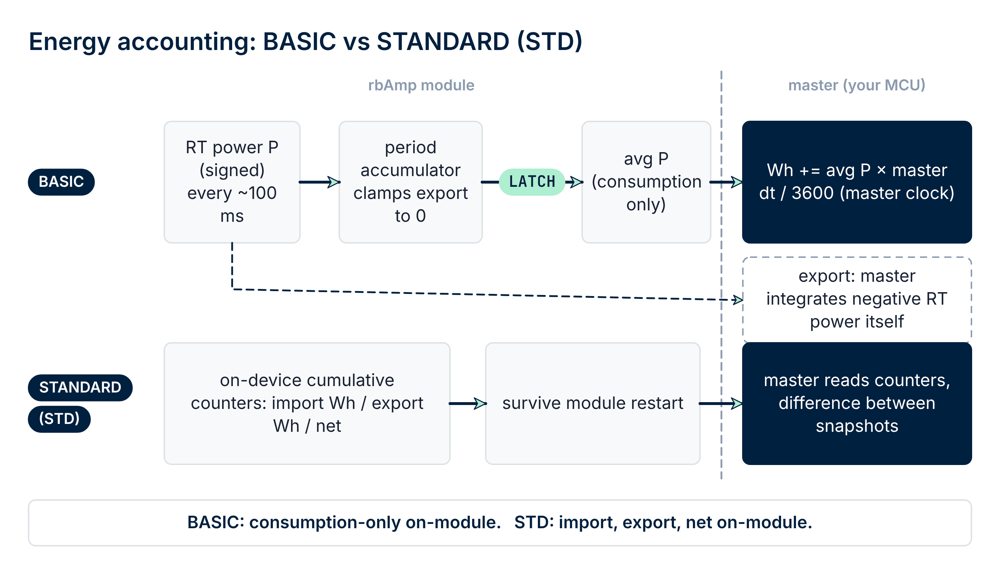

# 02 · Module tiers


## What a module line is

Check the label on your module; `dev.line()` prints the line after `begin()`.


**rbAmp** comes in module lines: **BASIC** and **STANDARD (STD)** (PRO is not
implemented). A module line is a complete pairing of **hardware revision and
firmware**, not a software flag. Moving between module lines requires a
physical SKU change, not a firmware update.

From the perspective of the library and your code: **one `RbAmp` class
serves both shipping lines**. `begin()` detects whether a module is BASIC or
STANDARD (STD) and routes every call internally; the common methods
(`readVoltage()`, `readCurrent()`, `readPower()`, `readPeriodSnapshot()`,
`energy()` …) work on both. The STD line adds calls of its own — reactive and
apparent power, per-channel block reads, signed life-time energy counters —
see [09 · API reference](09_api_reference.md#std-line-api).

## Current status

The **BASIC** tier and the **STANDARD (STD)** line are shipping module lines;
this library supports both (STANDARD (STD) from library 1.6.0, see the README).
PRO is not implemented.

| Tier | Shipping |
|---|---|
| **BASIC** | ✅ yes |
| **STANDARD (STD)** | ✅ yes (library 1.6.0+) |
| **PRO** | ❌ not implemented |

## BASIC — entry tier for consumer metering

### Hardware

A cost-optimized analog path suited to typical household loads. The
module includes an isolated analog front-end, an on-board power
regulator, and factory calibration stored in flash.

### Firmware behavior

The logic of a classic mechanical disk meter — **the count only moves
forward; export to the grid is not subtracted**.

The three "layers" of active-power values behave differently:

| Signal | Meaning | Behavior on BASIC |
|---|---|---|
| `dev.readPower(ch)` | instantaneous RT power, updated every ~100 ms | **signed** — a negative value is visible in real time (export) |
| `PERIOD_AVG_P_W` (inside `readPeriodSnapshot`) | average power over the period | each 100 ms window's average P is **clamped** to `max(P, 0)` before being added to the period accumulator |
| `dev.energy().wh(ch)` | Wh accumulated by the library | **monotonic** — consumption only; export is not counted |

In other words: the user **sees** export in the RT reading, but it is
absent from the library's Wh counter on BASIC.

### Typical use cases

- Households without on-site generation (no solar panels, wind
  turbines, or battery systems)
- Submeters for purely consuming loads (water heaters, motors,
  appliances)
- Building consumption monitoring where bidirectional metering is not
  required

### Bidirectional metering on BASIC (master-side)



If you need to track export to the grid separately on a BASIC module,
**do it on the master side**. The RT power `dev.readPower(0)` is
signed, so:

```cpp
double consume_wh = 0.0;
double export_wh  = 0.0;
uint32_t t_prev_ms = millis();

void loop() {
    // Sample RT power at 10 Hz — matches the firmware-commit cadence
    // (100 ms per channel). Faster gives empty repeat reads; slower
    // loses resolution on abrupt load transitions.
    //
    // delay() blocks the loop — incompatible with concurrent work
    // (LCD refresh, MQTT, networking). For sketches with other tasks,
    // replace it with a non-blocking millis() / scheduler pattern.
    delay(100);
    uint32_t t_now_ms = millis();
    float dt_s = (t_now_ms - t_prev_ms) / 1000.0f;
    t_prev_ms = t_now_ms;

    float p = dev.readPower(0);
    if (isnan(p)) return;

    double dwh = (double)p * dt_s / 3600.0;
    if (p >= 0) consume_wh += dwh;
    else        export_wh  += -dwh;
}
```

A complete working example is in [06_examples.md](06_examples.md) (the
`BidirectionalEnergy` scenario) and in [`examples/06_BidirectionalEnergy/`](https://github.com/rb-amp/rbamp-arduino/tree/main/examples/06_BidirectionalEnergy/).

## STANDARD (STD) — bidirectional line

STANDARD (STD) modules are a shipping module line. The library detects them in
`begin()` (`dev.line() == RbAmpLine::Std`) and uses the same wiring and the
same common API as BASIC (see [04 · Wiring](04_hardware.md)).

### What the STD line adds

On an STD module with persisted counters, the period/latch API and energy come
from the module's own counters (older STD images use the module's latch
banks); the CT model on STD is a label only and sets no gain.

- **Signed energy**: import and export are accounted separately. On modules
  that keep persisted life-time counters, `dev.energy()` and
  `readPeriodSnapshot()` take the module's own figures (`wh_net` = import −
  export), and `stdReadEnergy()` gives the raw counters (Wh, mWh and, on
  images that provide them, µWh / µvarh).
- **More quantities** (on BASIC, reactive power is not exposed by this library): `readReactivePower(ch)`, `readApparentPower(ch)`,
  `stdReadChannel(ch)` (I / P / Q / S / PF / peak in one burst), and, when
  enabled, harmonics-based values (THD, displacement PF).
- **Multi-channel / multi-voltage modules**: channel counts come from the
  module; `stdReadVoltage(v)`, per-phase totals with `stdReadTotals(k)`.
- **Diagnostics and service**: `stdReadHealth()`, module clock, history and
  event log, identification by UID, firmware update over I²C.

All of this is listed call by call in
[09 · API reference § STD line API](09_api_reference.md#std-line-api).

> **Image dependence.** Some STD features depend on the module's image
> version: micro-resolution energy counters, the starting current for energy,
> voltage phase angles and the phase sequence need a module image version of at least
> `0x0001007B` (`dev.stdReadImageVersion()`); on an older image they are
> reported as "not available". STD-only calls on a BASIC module return
> `RB_ERR_NOT_IMPLEMENTED`.

### Typical use cases

- Homes with rooftop solar generation
- Homes with wind turbines
- Battery storage systems
- Regenerative loads
- V2G (vehicle-to-grid) EV charging

## PRO

PRO is not implemented: there are no PRO modules and this library has no
PRO-specific API.

## How to detect the line at runtime


```cpp
if (!dev.begin()) { /* see dev.errorString() */ }

// Product line, detected by begin(): BASIC or STANDARD (STD)
RbAmpLine line = dev.line();          // RbAmpLine::Basic / RbAmpLine::Std

// Firmware version — opaque byte
uint8_t fw = dev.firmwareVersion();

// Presence of a voltage sensor (UI* variants vs I*-only)
bool voltage_hw = dev.hasVoltageHw();

// Number of current channels
uint8_t channels = dev.channels();

// Full SKU — variant byte (REG_HW_VARIANT)
RbAmpVariant variant = dev.readVariant();   // UI1, UI2, UI3, I1, I2, I3, UI5, UI7 …
```

> **Note**: `line()` tells you BASIC or STANDARD (STD). The other indicators
> (firmware version, channel count, voltage sensor, SKU) describe the
> hardware. The SKU label on the module's enclosure remains the source of
> truth for the product.

## Where tier-dependent items are flagged in the documentation

Throughout the library text and the canonical documentation,
tier-dependent features are flagged explicitly, for example:

> **STANDARD (STD) / PRO only** — this is not available on a BASIC
> module.

Or, conversely, BASIC-specific behavior:

> **BASIC**: the `dev.energy().wh(ch)` counter is monotonic — export
> to the grid is not counted. For bidirectional metering, see the
> `BidirectionalEnergy` example or use a STANDARD (STD) module.

## What's next

- [03 · Current sensor selection](03_sensor_selection.md) — which
  SCT-013 for which job
- [04 · Wiring](04_hardware.md) — hardware details
- [06 · Examples](06_examples.md) — scenarios for BASIC, including
  master-side bidirectional metering
- [09 · API reference](09_api_reference.md) — the full public API