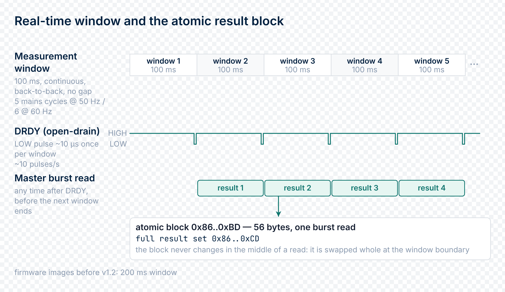

# 09 · API Reference


The public API of the `RbAmp` library for Arduino as of v1.6.1. One class
serves both module product lines — **BASIC** and **STANDARD (STD)**:
`begin()` detects the line and every call routes internally. Calls that
only exist on one line are marked; a call with no counterpart on the
detected line fails with `RB_ERR_NOT_IMPLEMENTED`. Source of truth — the
header files [`src/RbAmp.h`](https://github.com/rb-amp/rbamp-arduino),
[`src/RbAmpSnapshot.h`](https://github.com/rb-amp/rbamp-arduino),
[`src/RbAmpEnergy.h`](https://github.com/rb-amp/rbamp-arduino),
[`src/RbAmpSensorModels.h`](https://github.com/rb-amp/rbamp-arduino),
[`src/RbAmpRegisters.h`](https://github.com/rb-amp/rbamp-arduino) (the last
two are auto-generated and must not be edited by hand).

This chapter is a reference: signatures, return values, side
effects, edge cases. For working examples see
[06 · Examples](06_examples.md); for the quick start see
[05 · Quickstart](05_quickstart.md).

## Header files

| Include | What it brings in |
|---|---|
| `<RbAmp.h>` | All public types (pulls in the rest) |
| `<RbAmpSnapshot.h>` | `RbAmpSnapshot`, `RbAmpPeriodSnapshot`, `RbAmpTopology`, `RbAmpVariant`, `RbAmpLine`, `RbAmpSensorClass`, `RbAmpSctRating`, `RbAmpDrdyEvent` and the `RbAmpStd*` structures of the STD line |
| `<RbAmpEnergy.h>` | `RbAmpEnergy` |
| `<RbAmpSensorModels.h>` | Generated sensor-model registry — the `RBAMP_CT_*` model codes and `rbamp_sensor_model_lookup()` |
| `<RbAmpRegisters.h>` | Auto-generated protocol constants — `RB_OK`, `RB_ERR_*`, `SETTLE_MS_*` |

A user sketch normally only needs `#include <RbAmp.h>` — the rest
are pulled in transitively.

## Which line does a call work on?

| Group | BASIC | STD |
|---|:---:|:---:|
| Lifecycle, real-time reads (`readVoltage` … `readAll`), period metering, `energy()` | yes | yes |
| `readReactivePower()`, `readApparentPower()` | no (`RB_ERR_NOT_IMPLEMENTED`) | yes |
| Sensor class / CT model setters, `saveUserConfig()`, address change, `reset()` | yes | yes (CT model is a label on STD, see below) |
| `factoryReset()`, General-Call helpers, label helpers, `readCapability()`, `readCommitSeq()`, `readPeriodLatchMs()` | yes | no (`RB_ERR_NOT_IMPLEMENTED`) |
| Data-ready line and events (`setDrdyPin()`, `waitDataReady()`, `setEventMask()` …) | yes | yes (module image dependent, see below) |
| `std*` calls ([STD line API](#std-line-api)) | no (`RB_ERR_NOT_IMPLEMENTED`) | yes |
| SCT-013 rating correction (`sctRating*()`) | yes (SCT-013 class, older BASIC firmware) | never applied (scale 1) |

Some STD features depend on the **module image version**: micro-energy
counters, the starting current for energy, voltage phase angles and the phase
sequence need an image of at least `0x0001007B`
(`stdReadImageVersion()`). On an older image the library reports them as
"not available" (a `valid` flag that is `false`, a derived value, or
`RB_ERR_NOT_IMPLEMENTED`) — never as a wrong number.

## `RbAmp` class

The main client. One instance per slave device on the I²C bus.
Multiple instances can share a single `TwoWire` bus to poll several
modules.

### Constructor

```cpp
explicit RbAmp(TwoWire& bus,
               uint8_t addr = 0x50,
               RbAmpTopology hint = RbAmpTopology::Single) noexcept;
```

| Parameter | Description |
|---|---|
| `bus` | Reference to the `TwoWire` bus (usually `Wire`). The caller must call `bus.begin()` BEFORE `begin()`. |
| `addr` | 7-bit slave address. Range 0x08..0x77, default 0x50. |
| `hint` | Topology hint: the number of current channels (1/2/3). On pre-v1.3 firmware `begin()` cannot reliably determine the variant, so the hint is used as a fallback for multi-channel SKUs. Defaults to `Single` — the safe default, which does not trigger spurious reads of absent channels. For multi-channel modules on pre-v1.3 firmware, pass the matching hint explicitly. |

The constructor generates no I²C traffic.

### Lifecycle methods

#### `bool begin() noexcept`

Probe the device, detect its product line and variant, prime LATCH.

Sequence:

1. **STD identity probe first.** If the module answers as an STD module, the
   channel counts come from the module itself, latch bank 0 is armed and
   primed, and `begin()` returns — the BASIC steps below are skipped.
2. Read `REG_VERSION` (0x03). If the device did not ACK — `false`
   with `RB_ERR_NACK`. If it returned `0x00` / `0xFF` — `false` with
   `RB_ERR_VERSION`.
3. Cache the topology: the module's variant byte on firmware that exposes it,
   otherwise the constructor `hint`. After this, `topology()` /
   `channels()` return valid values without touching the bus. The channel
   count never exceeds `RBAMP_MAX_CHANNELS` (7); channels beyond that are not
   exposed and addressing them returns `RB_ERR_PARAM`.
4. Read `U_rms` to determine whether a voltage sensor is present
   (threshold 1.0 V).
5. Write `CMD_LATCH_PERIOD` as a primer + wait 50 ms. The first
   snapshot after power-on is discarded (it is not handed to user
   code — it mixes in pre-power-on data).
6. Store `millis()` for subsequent energy integration.
7. On a BASIC module with the SCT-013 class, read the per-channel rating
   correction (see [SCT-013 rating correction](#sct-013-rating-correction)).
   If the module is in the state that needs a restart to apply the right
   gain, `begin()` restarts it once.

Idempotent: safe to call again.

**Returns**: `true` on success; `false` otherwise — see
`lastError()` for details.

#### `bool probe() noexcept`

A lightweight liveness check. A single read of `REG_VERSION` with no
side effects.

**Returns**: `true` if the slave ACKed and reported a supported
version (neither `0` nor `0xFF`).

#### `bool waitReady(uint32_t timeout_ms = 1000) noexcept`

Polls the module's ready flag until bit 0 is set. Useful after
power-on — the module may need up to one measurement window (100 ms) to
commit its first data.

**Returns**: `true` if the bit was seen before `timeout_ms` elapsed;
`false` with `RB_ERR_TIMEOUT` otherwise.

#### `uint8_t firmwareVersion() noexcept`

**Returns**: the `REG_VERSION (0x03)` byte. Known BASIC values:
`0x01` = v1.0, `0x02` = v1.1, `0x03` = v1.2, `0x04` = v1.3. Later BASIC
firmware reports higher values. `0` or `0xFF` indicate an I²C error
(see `lastError()`).

#### `RbAmpLine line() const noexcept`

**Returns**: the product line detected by `begin()` — `RbAmpLine::Basic`
(the value until `begin()` has run) or `RbAmpLine::Std`. No bus access.

#### `RbAmpTopology topology() const noexcept`

**Returns**: the cached topology. No bus access.

#### `uint8_t channels() const noexcept`

**Returns**: the number of current channels, `1..RBAMP_MAX_CHANNELS` (7).
On the STD line the count is what the module reports, capped at
`RBAMP_MAX_CHANNELS`.

#### `bool hasVoltageHw() const noexcept`

**Returns**: `true` if a voltage sensor was detected at `begin()`.
Cached, no traffic.

#### `uint8_t address() const noexcept`

**Returns**: the current 7-bit I²C address. Updated after a
successful `commitAddressChange()`.

#### `uint8_t rawTopology() noexcept`

A direct read of `REG_TOPOLOGY` (0x24). Unlike `topology()`, this
performs an I²C transaction.

**Returns**:

- `1`/`2`/`3` — `SINGLE`/`SPLIT_PHASE`/`THREE_PHASE`.
- `0xFF` — I²C error.

> For full SKU detection use `readVariant()` (reads
> `REG_HW_VARIANT 0x55`) — see
> [Identification and provisioning](#identification-and-provisioning-v13).

### Real-time reads (RT block, 100 ms refresh)



All methods return `float`. On error they return `NAN` and set
`lastError()`. Under the hood a retry + sanity filter is used for
robustness against rare link glitches on ESP-IDF (see the diagnostic
counters below). The module publishes new values once per measurement
window — 100 ms (BASIC firmware before v1.2 and STD images up to `0x7B`:
200 ms).

#### `float readVoltage(uint8_t phase = 0) noexcept`

Instantaneous RMS voltage. `phase` is `0` on the BASIC line; on the STD line
it is `0 .. n_voltage-1` (see `stdInfo()`). An out-of-range phase returns
`NAN` with `RB_ERR_PARAM`.

#### `float readVoltagePeak(uint8_t phase = 0) noexcept`

Peak voltage over the RT window. Same `phase` rule.

#### `float readCurrent(uint8_t ch = 0) noexcept`

Instantaneous RMS current on a channel. `ch` must be < `channels()`
— otherwise `NAN` with `RB_ERR_PARAM`. This includes any channel at or
beyond `RBAMP_MAX_CHANNELS` (7).

#### `float readCurrentPeak(uint8_t ch = 0) noexcept`

Peak current on a channel over the RT window.

#### `float readPower(uint8_t ch = 0) noexcept`

Instantaneous active power on a channel. **Signed** — a negative
value means export (the load feeds power back into the grid, relevant
for PV / bidirectional installations).

#### `float readPowerFactor(uint8_t ch = 0) noexcept`

Power factor on a channel. Dimensionless, range −1..+1.

#### `float readReactivePower(uint8_t ch = 0) noexcept` — STD only

Reactive power on a channel, in var, signed. On BASIC, reactive power is not
exposed by this library: the call returns `NAN` with `RB_ERR_NOT_IMPLEMENTED`.

#### `float readApparentPower(uint8_t ch = 0) noexcept` — STD only

Apparent power on a channel, in VA. On a BASIC module returns `NAN` with
`RB_ERR_NOT_IMPLEMENTED`.

#### `float readFrequency() noexcept`

Grid frequency, in Hz.

#### `bool readAll(RbAmpSnapshot& out) noexcept`

The complete RT block in a single call, into a `RbAmpSnapshot`
struct. Equivalent to sequential `readVoltage()` + `readVoltagePeak()`
+ `readCurrent(0..N)` + `readCurrentPeak(0..N)` + `readPower(0..N)` +
`readPowerFactor(0..N)` + `readFrequency()`. Unused channels (beyond
`channels()`) are filled with zeros.

A single field that is read but fails the physical sanity filter is set to
`NAN` and flagged in `out.implausible` (`RBAMP_FIELD_*` bits); the rest of
the snapshot stays usable.

**Returns**: `true` unless a transport read failed — then `false` and
`lastError()` holds the code of the first error.

### Period metering

See [01 · Overview](01_overview.md) for the big picture and
[05 · Quickstart](05_quickstart.md) Step 5 for a minimal template.

#### `bool latchPeriod() noexcept`

Writes `CMD_LATCH_PERIOD` (0x27) to `REG_COMMAND`. Does not wait —
the caller itself must observe the 50 ms settle and check
`isPeriodValid()` before reading.

For most tasks use `readPeriodSnapshot()` — it encapsulates the
entire sequence.

**Returns**: `true` on a successful write.

#### `bool isPeriodValid() noexcept`

Reads the latch ready bit. `true` if the last snapshot is fresh and
ready to read.

#### `float readPeriodAvgPower(uint8_t ch = 0) noexcept`

Average active power on a channel over the latched period. Must be
called after `latchPeriod()` + 50 ms settle + valid check.

#### `float readPeriodMaxPower() noexcept`

Peak instantaneous power on channel 0 over the latched period.

#### `uint32_t readPeriodLatchMs() noexcept`

Period duration from the **device's** point of view, in ms.

> **Diagnostic value.** `latch_ms` is a module diagnostic timer; do not use it
> for energy — use the master clock (`master_dt_ms` from `RbAmpPeriodSnapshot`).

#### `bool readPeriodSnapshot(RbAmpPeriodSnapshot& out, uint16_t settle_ms = 50, bool skip_latch = false) noexcept`

**The recommended entry point** for period metering. The full
sequence under the hood:

1. If `skip_latch == true` — skip the LATCH write (applies after
   `broadcastLatch()` or a manual series of LATCH commands).
2. Otherwise — write `CMD_LATCH_PERIOD`.
3. Capture `millis()` to compute `master_dt_ms`.
4. `delay(settle_ms)` — 50 ms by default per the protocol
   specification.
5. Check the latch ready flag. If 0 — set `RB_ERR_STALE` and record
   the timestamp (so the next snapshot does not double-count by
   `dt`).
6. Read `avg_p[0..channels-1]` + `max_p` + `latch_ms`.
7. Update the timestamp + call `energy().tick(out, channels_)` for
   automatic Wh integration.

| Parameter | Description |
|---|---|
| `out` | Output struct. |
| `settle_ms` | Wait after LATCH, 50 by default. |
| `skip_latch` | If `true` — do not write LATCH, only read (for a synchronized multi-board scene). |

**Returns**: `true` if `out.valid == true`; `false` if the read
failed or the snapshot is stale.

On the STD line the settle after a latch is raised to at least 300 ms (the
module services the latch at its next measurement-window boundary), `latch_ms`
is `0` and `master_dt_ms` is the period. On an STD module that keeps persisted
life-time counters instead of latch banks, the period is the difference of two
counter readings on the master's schedule; `avg_p_total`, `wh_net` and
`module_restarted` of the snapshot are filled there.

### Energy metering (master-side accumulator)

#### `RbAmpEnergy& energy() noexcept`

#### `const RbAmpEnergy& energy() const noexcept`

Access to the per-channel Wh accumulator owned by this `RbAmp`
instance. The accumulator is updated automatically on every
successful `readPeriodSnapshot()`. For details see the "`RbAmpEnergy`
class" section below.

#### `double energyWh(uint8_t ch = 0) const noexcept`

The running energy total of a channel, like `energy().wh(ch)` — except on
an STD module that keeps persisted counters but publishes no per-channel split
(more than one channel, older register map): a per-channel request returns
`NaN` there instead of a `0` that would read as "nothing consumed". Use
`RBAMP_ENERGY_CH_TOTAL` as `ch` for the all-channel total.

### Sensor configuration

A two-step sequence: first the sensor class, then the model. **Both
steps are mandatory** on BASIC firmware v1.2 and later.

For a detailed model-selection guide see [03 · Current sensor selection](03_sensor_selection.md).

> **CT model — a functional preset on BASIC, a label on STD.** On a BASIC
> module, writing the CT model immediately applies the matching preset — the
> current readings change. Changing the `RbAmpSensorClass` resets the
> channels' CT models to 0 on the module. On an STD module the model is a
> reference (sensor label) only: it sets no gain, because the module is
> calibrated per channel.

> **Read-before-write.** The setters read the module first. Writing a class
> or model the module already holds is a no-op (`true`, no bus write, no
> flash cycle), so a stored configuration can be re-applied on every boot
> without touching the module's calibration. A module of class `WiredCT` or
> `BuiltinCT` (shipped and calibrated together with its sensor) is not
> reconfigured: the setter returns `false` with `RB_ERR_MODE` and writes
> nothing. `setCTModelChForce()` is the service path.

> **Setting a CT model restarts the module.** On BASIC firmware up to 1.4.19
> with the SCT-013 class, `setCTModel()` (both forms) and `configureChannels()`
> restart the module after the save so that the new model takes effect
> (about a second in total, blocking), then re-read the rating correction. Do not
> call them in a loop and do not expect readings during that time.

#### `bool setSensorClass(RbAmpSensorClass cls) noexcept`

Set the current sensor class with a save to flash.

Sequence: read the module's current class (read-before-write) → write
`REG_SENSOR_CLASS` (0x25) → `CMD_SAVE_USER_CONFIG` (0x32) → wait 700 ms
(flash erase). Blocking. **Production-OK** — `SAVE_USER_CONFIG` is not gated.

Must be called **before** `setCTModel()`. Otherwise `setCTModel()`
returns `false` with `RB_ERR_PARAM`. It also resets the CT models
to 0 on the device side, so set the models afterwards. On the STD line the
class is metadata, persisted with the module's config save, and the same
read-before-write rules apply.

| Argument | Meaning |
|:---:|---|
| `RbAmpSensorClass::Sct013` | SCT-013 series clamp fitted by the user; the model selects the sensor type |
| `RbAmpSensorClass::WiredCT` | wired CT shipped with the module and calibrated together with it — not rewritten by the setters |
| `RbAmpSensorClass::BuiltinCT` | built-in CT, calibrated together with the module — not rewritten by the setters |

**Returns**: `true` on success, or when the module already holds `cls`.
`false` with `RB_ERR_MODE` when the module is of class `WiredCT` /
`BuiltinCT`.

#### `bool readSensorClass(uint8_t& out) noexcept`

Reads the module's current sensor class (an `RbAmpSensorClass` value;
`0` = unset). Works on both lines.

**Returns**: `true` on success.

#### `bool setCTModel(uint8_t code) noexcept`

The single-parameter form — sets the CT clamp model **on channel 0
only**. Convenient for single-channel SKUs (UI1/I1); on multi-channel
ones it is equivalent to `setCTModel(0, code)`.

Sequence: write `REG_CT_MODEL` (0x05) → `CMD_SET_CT_MODEL_CH0` (opcode 0x28) → 5 ms settle → `CMD_SAVE_USER_CONFIG` (opcode 0x32) → 700 ms. **Production-OK** — uses the user-config save path, no factory-mode gating.

Name the model with the generated `RBAMP_CT_*` define (from
`RbAmpSensorModels.h`), for example `RBAMP_CT_SCT013_030`:

| Define | `code` | Model |
|---|:---:|---|
| `RBAMP_CT_SCT013_005` | 1 | SCT-013-005 |
| `RBAMP_CT_SCT013_010` | 2 | SCT-013-010 |
| `RBAMP_CT_SCT013_030` | 3 | SCT-013-030 |
| `RBAMP_CT_SCT013_050` | 4 | SCT-013-050 |
| `RBAMP_CT_SCT013_100` | 5 | SCT-013-100 |
| `RBAMP_CT_SCT013_020` | 6 | SCT-013-020 |
| `RBAMP_CT_SCT013_060` | 7 | SCT-013-060 |

A `code` that is not in the registry for the module's class → `false` with
`RB_ERR_PARAM` and no write. A code that is in the registry but that the
module does not accept is rejected by the module with `RB_ERR_PARAM`; the
channel keeps its previous model. For the full per-class accept-set see
[03 · Current sensor selection](03_sensor_selection.md#choosing-an-sct-013-model).

For multi-channel modules use the per-channel form below.

#### `bool setCTModel(RbAmpCTModel model) noexcept`

Typed-enum overload for the seven SCT-013 codes (`RbAmpCTModel::Sct013_030`
…). Equivalent to `setCTModel(static_cast<uint8_t>(model))`. Kept for
backward compatibility; new code passes a generated `RBAMP_CT_*` define to the
`uint8_t` form, which is the only way to name a wired-CT model.

#### `bool setCTModel(uint8_t channel, uint8_t code) noexcept`

The per-channel form. Sets the CT clamp model on a specific channel,
`0 .. channels()-1` (channels 3 and up are the senior-SKU channels; they need
BASIC firmware v1.4.18 or later).

Under the hood: write `REG_CT_MODEL` (0x05) → command `CMD_SET_CT_MODEL_CH0/1/2`
(opcode 0x28/0x29/0x2A) according to `channel` → 5 ms settle → `CMD_SAVE_USER_CONFIG`
(opcode 0x32) → 700 ms. **Production-OK** — the user-config save path is the
production persistence channel for `ct_model` / `sensor_class` / per-channel CT.
Channels 3 and up are bound through the channel window and read back; a model
the module rejects is reported as `RB_ERR_PARAM`. On firmware older than
v1.2 the call returns `RB_ERR_VERSION`.

> **Call order is arbitrary on v1.3.** Writing
> `REG_CT_MODEL (0x05)` only **stages** a value — it is **not** auto-
> applied to channel 0. Application happens **exclusively** through
> the per-channel opcode `CMD_SET_CT_MODEL_CHn` (0x28 / 0x29 / 0x2A),
> which copies the staged value into its own channel. Channels can
> therefore be configured in any order — ascending, descending, or
> interleaved — without clobber:
>
> ```cpp
> dev.setCTModel(0, RBAMP_CT_SCT013_005);   // channel 0
> dev.setCTModel(1, RBAMP_CT_SCT013_030);   // channel 1
> dev.setCTModel(2, RBAMP_CT_SCT013_020);   // channel 2
> ```
>
> After a multi-channel bind, confirm the result with `readCTModelCh()`.
> For a batched, one-save configuration of all channels prefer
> `configureChannels()`.

`RB_ERR_PARAM` guard on the `setSensorClass()` precondition, same as
in the single-parameter form. A channel at or beyond `channels()` (and so
any channel beyond `RBAMP_MAX_CHANNELS`) → `RB_ERR_PARAM`. Read-before-write
and the `RB_ERR_MODE` refusal apply as described above. On the STD line the
model is a label written to the per-channel entry, read back and persisted
with the module's config save; no channel-0 side effect.

**Returns**: `true` on success, or when the channel already holds `code`.

#### `bool setCTModel(uint8_t channel, RbAmpCTModel model) noexcept`

Typed-enum overload of the per-channel form (SCT-013 codes only).

#### `bool setCTModelChForce(uint8_t channel, uint8_t code) noexcept`

**Service path.** Same as `setCTModel(channel, code)` but writes regardless of
the module's class and of the model the channel currently holds. It replaces
the paired calibration of that channel with the model's generic preset — use
it only when re-pairing a module with a new sensor in service, and follow it
with a calibration. A code absent from the registry is still rejected
(`RB_ERR_PARAM`, no write).

**Returns**: `true` on success.

#### `bool readCTModelCh(uint8_t channel, uint8_t& out) noexcept`

Reads the CT model actually applied to a channel (the verify mirror of the
bound preset). Use it to confirm that a bind took. `out = 0` means unset.

**Returns**: `true` on success.

#### Sensor registry — `sensorModel()` / `sensorModelRatedA()`

Pure lookups in the generated registry (`RbAmpSensorModels.h`). **No bus
traffic.** A registry hit does not mean the connected module accepts the code
— that is decided by the module at write time.

```cpp
static const rbamp_sensor_model_info_t* RbAmp::sensorModel(uint8_t cls, uint8_t code) noexcept;
static const rbamp_sensor_model_info_t* RbAmp::sensorModel(RbAmpSensorClass cls, uint8_t code) noexcept;
static float RbAmp::sensorModelRatedA(uint8_t cls, uint8_t code) noexcept;
static float RbAmp::sensorModelRatedA(RbAmpSensorClass cls, uint8_t code) noexcept;
```

`sensorModel()` returns the registry entry or `nullptr` if `(class, code)` is
not in the registry. The entry (`rbamp_sensor_model_info_t`) carries
`sensor_class`, `code`, `name`, `descriptor`, `status` (characterized /
reserved / legacy) and the current limits `nominal_a` (rated RMS current),
`fs_a` (RMS current at the onset of clipping for a sine) and `peak_a`
(instantaneous clipping ceiling). `0` in a limit = not known for that model.

`sensorModelRatedA()` returns the rated RMS current in amperes (`0` = not
known). It covers the SCT-013 family and the clamp models that carry a
rating; legacy toroid / burden codes return `0`.

```cpp
float rated = RbAmp::sensorModelRatedA(RbAmpSensorClass::Sct013, RBAMP_CT_SCT013_030);
const rbamp_sensor_model_info_t* m = RbAmp::sensorModel(RbAmpSensorClass::Sct013, RBAMP_CT_SCT013_030);
if (m) Serial.println(m->descriptor);
```

#### SCT-013 rating correction

On BASIC firmware up to 1.4.19 a module with the SCT-013 class is calibrated
on the SCT-013-030 and, after a restart, applies that calibrated gain
whatever model a channel shows. The library compensates: `begin()` reads each
channel's model and applied gain and sets a per-channel **scale**. The
scale is applied to `readCurrent()`, `readCurrentPeak()`, `readPower()`,
`readAll()`, `readPeriodAvgPower()`, `readPeriodMaxPower()` and
`readPeriodSnapshot()` — and therefore to the energy derived from them.
**Power factor and voltage are not touched.** Plausibility bounds and
`setEventThresholds()` are expressed in true amperes / watts.

So changing the SCT-013 rating (for example from 030 to 050) auto-corrects
current, power and energy; it does not change U or PF. Firmware 1.4.20 and
later corrects itself — the scale stays 1 and a model write needs no
restart. STD modules and the wired / built-in CT classes are never scaled.

##### `bool sctRatingRefresh() noexcept`

Re-reads each channel's rating state from the module. The library already
does this after `readEventFlags()` reports `EVENT_RESET_OCCURRED`; call it
yourself after a module restart you detect some other way.

**Returns**: `true` when the module could be read.

##### `bool sctRating(uint8_t channel, RbAmpSctRating& out) noexcept`

State of one channel: `model`, `applied_gain`, `noise_floor`, `scale` and
`status`.

**Returns**: `true` if `channel` is valid.

| `RbAmpSctRatingStatus` | Meaning |
|---|---|
| `NotApplicable` | STD line, a class other than SCT-013, firmware that corrects itself, or no model set — scale 1 |
| `Native` | the channel shows the model the module was calibrated on (030) — nothing to correct, scale 1 |
| `Corrected` | another SCT-013 model on older BASIC firmware — readings are scaled |
| `Uncalibrated` | the module applies a generic preset without its own trim — nominal correction only |
| `UnexpectedGain` | the applied gain is not what the correction expects — nothing is assumed, scale 1 |
| `Unknown` | the state could not be read — scale 1 |

##### `float sctRatingScale(uint8_t channel) const noexcept`

The factor applied to that channel's current / power readings (`1.0` when
nothing is corrected, and for a channel index beyond `RBAMP_MAX_CHANNELS`).

##### `static float sctPresetGain(uint8_t model) noexcept`

The library's preset gain figure for an SCT-013 model code; `0` if unknown.
Mostly useful for diagnostics.

#### `bool configureChannels(RbAmpSensorClass cls, const uint8_t* models, uint8_t n) noexcept`

See [Multi-channel configuration](#multi-channel-configuration-v13).

#### `bool saveGains() noexcept` — factory-mode only on BASIC

A "bare" `CMD_SAVE_GAINS` (0x26) write — the **factory** persistence
path for calibration coefficients (gains / noise floor / phase).

> ⚠ **Factory-only on BASIC. BLOCKED in production.** On a production BASIC
> module `CMD_SAVE_GAINS` is rejected by the firmware — the call returns
> `false`, `REG_ERROR` is set to `DEV_ERR_PARAM` (0xFE), and the next
> reboot reverts any RAM-only writes. For all user-facing persistence
> (sensor class, CT model per channel, address, fleet config, label)
> use `saveUserConfig()` (`CMD_SAVE_USER_CONFIG`, opcode 0x32) — that
> is the production-OK persistence path. User code in a deployment context
> **should not call `saveGains()`**.

**STD line:** `saveGains()` issues the module's calibration save, waits until
the module reports the command finished and checks its verdict. The module
writes its store at most once per 5 s; a save inside that window is retried
once after 5 s.

**Returns**: `true` on a successful command (BASIC production: always
`false` with `RB_ERR_MODE`).

#### `bool prepareAddressChange(uint8_t new_addr) noexcept`

Step 1 of 2 for changing the module's I²C address. **Production-OK** on the current firmware (v1.3 two-phase commit, no factory-mode gating for the address).

Sequence: validate the `new_addr` range (0x08..0x77, ≠ current) → write the candidate to `REG_I2C_ADDRESS (0x30)` in RAM → write magic `0xA5` to `REG_ADDR_COMMIT_MAGIC (0x31)` — armed. The caller must call `commitAddressChange()` within 5 seconds, otherwise the arming expires.

**Returns**: `true` if armed successfully.

#### `bool commitAddressChange() noexcept`

Step 2 of 2. Must be called within 5 seconds of `prepareAddressChange()`.

Sequence: check the freshness of the magic-armed state → `CMD_COMMIT_ADDR (opcode 0x30)` → persist to flash → `CMD_RESET (0x01)` → ~300 ms boot-to-responsive → update the internal address field. After this, all calls on this instance address the new address.

> ⚠ **Re-enumeration after commit.** After a successful commit the device resets and re-enumerates at the NEW address. Subsequent calls on this `RbAmp` instance address the new address transparently — but any OTHER master on the bus (a Python script, an ESP-IDF component on another MCU, a debug probe) will keep thinking the device is at the old address until its internal state is updated by hand.

> ⚠ **Verification path** (v1.3): after reboot `REG_I2C_ADDRESS (0x30)` reads the **active address**. A bus scan at the new address also works to confirm the commit.

> The address change is a **production operation** (not factory-only).
> The I²C address — the documented path is reconfiguration via the
> factory bench (outside the library's scope).

An additional note for `commitAddressChange()`:

> ⚠ **Restart and re-enumeration after commit.** After a successful
> commit the device resets and re-enumerates at the NEW address.
> Subsequent calls on this `RbAmp` instance address the new address
> transparently — but any OTHER master on the bus (a Python script,
> an ESP-IDF component, a debug probe) will keep thinking the device
> is at the old address until its internal state is updated by hand.

If the arming window has expired, `commitAddressChange()` returns
`false` with `RB_ERR_TIMEOUT` and clears the arming flag — a fresh
`prepareAddressChange()` will be required.

**Returns**: `true` on success.

**STD line:** the address field is written and saved (the call waits for the
save to finish; a rejected address returns `RB_ERR_PARAM` and the module keeps
its address), then the module is reset. The instance switches to the new
address only once the module answers there (up to 3 s). If it comes back on
the OLD address instead, the instance stays there and `RB_ERR_NOT_READY` is
returned.

#### `bool factoryReset() noexcept`

The `CMD_FACTORY_RESET` command (0xAA) + wait 1500 ms.

> ⚠ **Destructive operation.** Erases ALL flash parameters (CT
> model, sensor class, calibration coefficients, I²C address). The
> module returns to its factory defaults — `RbAmpSensorClass`
> becomes `Unset`, `REG_CT_MODEL` becomes 0. Any setting previously
> applied via `setSensorClass()` / `setCTModel()` is gone. The next
> user MUST re-apply both `setSensorClass()` and `setCTModel()`
> before metering works again. This is **not a "soft restart"** —
> for a soft restart use `reset()`. `factoryReset()` is reserved for
> recovery from a known-bad state or for handing the module off to
> another user / another installation.

**Returns**: `true` on a successful command write.

**STD line:** there is no counterpart — the call returns `false` with
`RB_ERR_NOT_IMPLEMENTED`.

#### `bool reset() noexcept`

The `CMD_RESET` command (0x01) + wait 100 ms. A soft restart of the
device without losing flash parameters.

**Returns**: `true` on a successful command write.

**STD line:** waits for any running command first (a module is never reset
mid-save), then waits quietly (up to 3 s) for the module to answer again and
re-arms the period path.

### Multi-module bus (static)

#### `static bool broadcastLatch(TwoWire& bus) noexcept`

Sends an I²C General-Call broadcast latch (`A5 27 00 tick_lo tick_hi`
to address `0x00`) — all modules with GC enabled latch the period
simultaneously. On v1.3 firmware GC is supported as an **opt-in
capability**: per-module enable via `REG_FLEET_CONFIG.bit0` (cleared by
default); the module's capability map says whether it supports the
General-Call latch. General-Call is a BASIC-line feature (the General-Call
and label helpers return `RB_ERR_NOT_IMPLEMENTED` on an STD instance).

**Return semantics**:

- **v1.3 firmware, GC enabled on at least one module** — returns `true`,
  the fleet latches in sync (skew < 1 ms across modules).
- **v1.3 firmware, GC disabled on all modules** — `Wire.endTransmission()`
  to `0x00` NACKs at the bus level → returns `false`. Fix: enable GC
  per module via `enableGc(true)` (writes `FLEET_CONFIG.bit0` +
  `SAVE_USER_CONFIG` + reset), or use `RbAmpFleet::enableGcAll()`.
- **Legacy firmware without General-Call support** —
  returns `false` without touching the bus. Fall back to a sequential
  series of `latchPeriod()` on each device — see
  [06 · Examples](06_examples.md), the multi-module bus section.

### Diagnostics

#### `int8_t lastError() const noexcept`

**Returns**: the code of the last error — `RB_OK` (0) or one of the
`RB_ERR_*` values (negative). The full table is in the "Error codes"
section below + [10 · Troubleshooting](10_troubleshooting.md).

#### `static const char* errorString(int8_t code) noexcept`

**Returns**: a constant string with a human-readable description of
the error code. Never returns `NULL`.

#### `void setLogStream(Stream* stream) noexcept`

An optional diagnostics sink. If set, the library briefly logs the
results of `probe()`, stale snapshots, and mode rejections. Pass
`nullptr` to turn it off. Off by default.

Typical use:

```cpp
dev.setLogStream(&Serial);
```

#### `uint32_t retryExhaustionCount() const noexcept`

How many times since power-on (or the last `resetCounters()`) the
retry loop was exhausted during a single-byte read. The steady-state
value is **0**. A non-zero value is a sign of link problems (see
[10 · Troubleshooting](10_troubleshooting.md)).

#### `uint32_t sanityRejectCount() const noexcept`

How many raw float values were rejected by the sanity filter
(`!isfinite(x) || |x| > 10000`). Steady-state — **0**. A non-zero
value after retry mitigation usually means a rare ESP-IDF I²C-stack
artifact that survived the retry layer.

#### `void resetCounters() noexcept`

Zero both counters. Use it at the start of a soak test or a
regression window to measure only the events within the window.

#### `const char* errorString() const noexcept`

Instance shortcut for `errorString(lastError())`. Never returns `NULL`.

#### `bool readCommitSeq(uint8_t& out) noexcept` — BASIC only

Reads the module's commit sequence byte. The module increments it once per
published measurement window (100 ms on firmware v1.2+, 200 ms before),
wrapping 255→0. Sample it before and after a multi-register read to detect
that the published values advanced mid-read. It is a change flag only — there
is no CRC. On an STD instance the call fails with `RB_ERR_NOT_IMPLEMENTED`
(use `readDataSeq()`).

**Returns**: `true` on success.

## Identification and provisioning (v1.3)

These methods let the master understand **exactly what** is connected
to the bus (variant, capability bit-map, UID, label) and prepare a
new or freshly flashed module for operation (provisioning + saving
the configuration to flash).

### `RbAmpVariant readVariant() noexcept`

Reads the module's `HW_VARIANT (0x55)` register and returns an
`RbAmpVariant`:

| Value | SKU | I channels | U channel |
|---|---|---|---|
| `UI1` (1) | UI1 | 1 | yes |
| `UI2` (2) | UI2 | 2 | yes |
| `UI3` (3) | UI3 | 3 | yes |
| `I1` (4) | I1 | 1 | no |
| `I2` (5) | I2 | 2 | no |
| `I3` (6) | I3 | 3 | no |
| `UI5` (7) | UI5 (senior SKU) | 5 | yes |
| `UI7` (8) | UI7 (senior SKU) | 7 | yes |
| `Unknown` (0) | not identified (firmware v1.0/v1.1, an I²C failure, or not an rbAmp) | — | — |

> **Variant autodetect via `readVariant()` is the recommended path**.
> The constructor topology hint remains as a **fallback for pre-v1.2
> firmware** (where `HW_VARIANT` is not available). Default hint =
> `RbAmpTopology::Single` — safe, it does not trigger spurious reads of
> absent channels on UI1/I1.

### `bool readCapability(uint16_t& out) noexcept` — BASIC only

Reads the module's 16-bit feature map. Branch on the named capability
constants of `RbAmpRegistersV2.h` (namespace `rbamp::v2`), never on
firmware-version heuristics. Among other things the map says whether the
module has a voltage front-end — if not, it does not compute P / PF / energy
and those values read `0` — and whether it supports the General-Call
broadcast latch (see `broadcastLatch()`). On an STD instance the call returns
`false` with `RB_ERR_NOT_IMPLEMENTED`; use `stdInfo()` there.

### `uint8_t readProductId() noexcept`

Reads `PRODUCT_ID (0x54)` — the byte identifier of the family
(rbAmp sensor = `0x01`, rbDimmer = `0x02`; `0` on failure). Used by the
fleet scanner to confirm that the device at an address really is an rbAmp
and not some other I²C slave that happened to respond at the same address.
An STD instance reports the sensor family.

### `bool readUid(uint8_t uid[12]) noexcept`

Reads the 96-bit unique MCU identifier from `UID (0x5C..0x67)` in a
single burst operation. The UID is guaranteed unique for every
module and does not change on re-flash — convenient for serial logs,
master-side anti-clone checks, and identification when a module is
replaced in a deployed fleet. Works on both lines.

### `bool readLabel(char out[9]) noexcept` — BASIC only

Reads the 8-byte user label from `LABEL (0x68..0x6F)`. ASCII,
zero-padded; the result is always null-terminated (a 9-byte array =
8 data bytes + the terminating `\0`). An empty label = unset.

### `bool writeLabel(const char* label) noexcept` — BASIC only

Writes the 8-byte label. Accepts a null-terminated string — extra
bytes are truncated, missing ones are padded with zeros. The write
is **byte-at-a-time** for multi-byte writes (the rbAmp wire protocol
auto-increments **register reads** in burst mode, but not register
writes — see [Wire-protocol details](#wire-protocol-details) below;
the library does the byte loop automatically). After the write you
need `dev.saveUserConfig()` so the label survives a reset.

> A module fresh from the factory can report error `0xFB`
> (`DEV_ERR_FLASH_PARAMS_BAD`) on its first boot: the user-config block is
> still empty. This is **normal** (not fatal); `saveUserConfig()` clears it.
> Do not abort provisioning on the first sight of `0xFB`.

### `bool saveUserConfig() noexcept`

Issues `CMD_SAVE_USER_CONFIG (opcode 0x32)` — saves the user-config
block to flash: `SENSOR_CLASS`, `CT_MODEL` per channel,
`I2C_ADDRESS`, `FLEET_CONFIG`, `GROUP_ID`, `LABEL`. It does **not
save** factory-cal parameters — those are under a separate
`CMD_SAVE_GAINS`, locked in production mode.

Blocks the thread for ~700 ms (flash erase + write cycle). For the
duration of the call, do not try to access the module from other
tasks.

**STD line:** issues the module's config save (class, CT reference, tier,
I²C address; calibration is preserved), waits until the module reports the
command finished (no fixed sleep) and checks its verdict — an invalid field
(for example an out-of-range address) returns `RB_ERR_PARAM`. A save inside
the module's 5 s store rate limit is retried once after 5 s.

> **Read-back ≠ persistence**: confirming that a value was written to
> flash requires a **reboot + a re-read**. See the "v1.3 error model"
> section below.

## v1.3 error model — two independent channels

Errors have **two independent channels** that work in different ways.
Understanding the difference is critical to interpreting the module's
state correctly.

| | Channel A — client-side, sync | Channel B — DUT-side, durable async |
|---|---|---|
| **Where it lives** | Validation inside the library (Arduino lib) | `REG_ERROR (0x02)` + `EVENT_FLAGS.bit3` (`0x2A`) |
| **When it fires** | Before the I²C transaction (the lib stops it) | After the FW accepted the write and rejected it |
| **What the master sees** | the setter returns `false` + `lastError() == RB_ERR_PARAM`; `REG_ERROR` on the device **stays 0x00** | `REG_ERROR` = the failure code immediately; `bit3` latches **a few hundred milliseconds** after the transaction |
| **Sticky** | no (just a bool return) | `REG_ERROR` last-write; `bit3` sticky W1C |
| **Typical path** | An argument outside the allowed bounds (channel ∉ {0,1,2}, code ∉ the characterized set, sensor_class out-of-enum) | A raw register write the library does not pre-validate (low-level use of `writeReg()` with an invalid mask) |

### Channel A — client-side validation (library setters)

All library setters (`setSensorClass`, `setCTModel`,
`setCTModel(ch, code)`, `configureChannels`, etc.) first **check the
arguments** against the allowed values. If an argument is out of
range, the setter returns `false` and sets
`lastError() == RB_ERR_PARAM`, **without performing any I²C
transaction at all**. Accordingly, `REG_ERROR` on the device is
**not touched**:

```cpp
if (!dev.setCTModel(/*ch=*/99, /*code=*/3)) {       // client-side guard
    Serial.print(F("rejected: "));
    Serial.println(dev.lastError());                 // RB_ERR_PARAM (lib cached)
    uint8_t reg_err = dev.readLastError();           // device REG_ERROR byte
    Serial.println(reg_err, HEX);                    // 0x00 — REG_ERROR untouched
}
```

> **`lastError()` vs `readLastError()` — two different channels, not
> synonyms.** `lastError()` returns the **lib-side cached** `RB_ERR_*`
> code from the previous call — **with no I²C operation**.
> `readLastError()` does a **single wire read** of the device's
> `REG_ERROR (0x02)` register — the last-write outcome from the
> firmware side. In Channel A (above), `lastError()` = `RB_ERR_PARAM`
> while `readLastError()` = `0x00` (the lib never reached the wire —
> REG_ERROR untouched). In Channel B (below) both will show a code,
> but differently: `lastError()` — the last cached lib semantics;
> `readLastError()` — the exact value of the REG_ERROR byte right now.

This means: if you want to know **exactly why** a setter refused, the
reliable source is the function's **return code** + `lastError()`.
`REG_ERROR` on the device will tell you nothing in this scenario.

### Channel B — DUT-side rejection (durable async)

If the write **went through I²C** (the lib did not stop it because
the argument looked valid) but the **firmware rejected** it, the
second channel kicks in:

- **`readLastError()`** immediately holds the reason code (for
  example, `0xFE = DEV_ERR_PARAM`). This is the last-write outcome:
  any next successful write will overwrite it. You must read it
  **immediately** after your write, before any other transaction.
- **`hasError(out)`** — the sticky W1C indicator `EVENT_FLAGS.bit3`.
  It **does not latch instantly**: on the bench a delay of **a few hundred milliseconds
  delay** was measured between the failed transaction and bit3 being
  set. Right after the write bit3 is still `false`; after 300 ms it
  is `true`. After that, `bit3` holds across any number of reads.

> ⚠ **Do not use `hasError()` to validate a write you just made.**
> For the outcome of **this specific write** only `readLastError()` is
> reliable, read **immediately** after the write before any other
> transaction (plus the setter's return code, if it has one).
> `hasError()` is an async channel for polling-style monitoring of
> "did anything fault between two checks", not for synchronous
> validation.

### Clearing a durable error — clear both (REG_ERROR and bit3)

`bit3` is picked up by the firmware every few hundred milliseconds from the
current state of `REG_ERROR`. So a plain `clearEventFlags(1 << 3)`
**will not work** — bit3 will immediately be **re-set** from the
not-yet-cleared `REG_ERROR`. The correct order: first `clearError()`
(clears `REG_ERROR`), then `clearEventFlags(1 << 3)` (clears the
sticky latch). If you want atomicity — there must be no rejected
write between them.

### `uint8_t readLastError() noexcept`

Reads the device's `REG_ERROR (0x02)` register directly (a single
wire read; returns `0x00` for OK, `0xFA..0xFF` for an error class, and `0xFF`
if the I²C read itself failed) — the outcome of the **last transaction successfully
accepted by the bus** (a write or a command). Not sticky: any next
successful write overwrites it with its own outcome. Used in Channel
B (DUT-side rejection) for the extended reason code. On the STD line
the command verdict is already mapped to `lastError()` (see the
[STD line API](#std-line-api)).

> **Not to be confused with `lastError()`**: that is a **different**
> method, which returns the library-cached `RB_ERR_*` from the
> previous lib call **with no I²C operation**. See the callout in
> Channel A above.

### `bool hasError(bool& out) noexcept`

A convenience helper over `EVENT_FLAGS.bit3`. Returns `true` in `out`
if bit3 is set. Sticky W1C; not cleared until an explicit clear (with
a caveat — see the "Clearing a durable error" section above).

### `bool readEventFlags(uint8_t& out) noexcept` / `bool clearEventFlags(uint8_t mask) noexcept`

`EVENT_FLAGS (0x2A)` — a byte of sticky flags; the specific bits are
described in the specification (including `ERROR_OCCURRED` bit3).
Clear is write-1-to-clear: write a mask with ones in the bits you
want to reset.

### `bool clearError() noexcept`

Issues `CMD_CLEAR_ERROR (opcode 0x31)` — zeros `REG_ERROR`.
**Required to clear a durable error** paired with
`clearEventFlags(1 << 3)` (see above). Without `clearError()`, a
simple `clearEventFlags(1 << 3)` will leave bit3 `true` after
a few hundred milliseconds because of re-latch.

## Multi-channel configuration (v1.3)

On multi-channel modules each current channel has its own CT sensor model.
The atomic utility for bulk configuration is `configureChannels()`.

### `bool configureChannels(RbAmpSensorClass cls, const uint8_t* models, uint8_t n) noexcept`

Parameters:
- `cls` — the sensor class, applied first. With `RbAmpSensorClass::Sct013`
  the models are bound; a request to bind models under `WiredCT` /
  `BuiltinCT` is refused up front (`false`, `RB_ERR_MODE`, nothing written).
- `models` — an array of `n` CT-model codes (generated `RBAMP_CT_*` defines),
  one per channel. `0` leaves that channel's existing model untouched.
- `n` — the array length. **Clamped** to `channels()`: extra array
  elements are ignored. If `n` is smaller — the missing channels are
  left untouched (they keep their previous model).

Internally the function performs:

1. `setSensorClass(cls)` once.
2. For each channel `k < min(n, channels)`: stage `REG_CT_MODEL = models[k]` + `CMD_SET_CT_MODEL_CHk`.
3. **One** terminal save at the end — one flash erase + write cycle for the
   whole configuration instead of one per channel (about 3× fewer wear
   cycles on three channels).

Read-before-write applies: a class or model the module already holds is not
rewritten, so re-applying the same configuration costs only reads and no
flash cycle. On BASIC firmware up to 1.4.19 with the SCT-013 class, the
module is restarted after the save (see
[Sensor configuration](#sensor-configuration)).

Return:
- `true` — the configuration was applied and saved (or was already in place).
- `false` + `lastError() == RB_ERR_PARAM` — an invalid `cls` or a
  `models[k]` that is not in the registry (client-side validation, see
  "Error model" above); the batch is aborted.
- `false` + `RB_ERR_MODE` — the module is of a factory-paired class.
- `false` + other codes — bus error, timeout, etc.

> Accepted codes for `SCT_013`: `{1, 2, 3, 4, 5, 6, 7}` (SCT-013-005, -010,
> -030, -050, -100, -020, -060). Details — [03 · Current sensor selection](03_sensor_selection.md).

### `bool readCTModelCh(uint8_t ch, uint8_t& out) noexcept`

Reads the applied (verify-mirror) CT sensor model on a specific channel.
This is a **read-back from RAM**, not a confirmation of persistence —
to confirm a flash save use `dev.reset()` + a re-read of the mirror.

## Data-ready line and events

Both lines. The module's `DRDY` output is open-drain, idle HIGH (host
pull-up), and pulses LOW each time a new complete snapshot is published —
once per measurement window (100 ms). Several modules may share one line
(wired-OR). A module whose masked event is pending holds the line **solid
LOW** (alarm level) until the flags are cleared. On the STD line the event
block exists on modules whose image provides it; on BASIC from firmware v1.3.
Hardware details — [04 · Wiring](04_hardware.md#data_ready-drdy).

#### `bool setDrdyPin(int pin) noexcept`

Attach the `DRDY` line of this module (or detach with `pin < 0`). Configures
the pin as an input with the internal pull-up and a falling-edge interrupt;
the ISR only counts and time-stamps the edge — no bus traffic there. Up to 4
distinct lines and 8 modules per line. An STD module whose image does not
support the data-ready contract refuses with `RB_ERR_NOT_IMPLEMENTED`;
`waitDataReady()` then polls the sequence. Without a line `waitDataReady()`
polls as well.

#### `bool waitDataReady(uint32_t timeout_ms, RbAmpDrdyEvent* ev = nullptr) noexcept`

Block until this module publishes a new snapshot (or an alarm), at most
`timeout_ms` (`0` = one non-blocking check).

With a line: waits for the edge, then confirms it was this module's by its
snapshot sequence (a pulse from another module on a shared line is ignored).
If the line is still LOW shortly after the edge, some module on it holds an
alarm: the flags of every alarm-capable module on the line are read and
cleared; this module's flags come back in `ev`, the others' are parked on
their instances and reported by their next wait. Without a line it polls the
sequence every `RBAMP_DRDY_POLL_MS` (default 20 ms; define it before including
the library to override).

**Returns**: `true` with `ev` filled; `false` with `RB_ERR_TIMEOUT` when
nothing arrived, `RB_ERR_NOT_IMPLEMENTED` on an STD module whose image has no
publish counter.

#### `bool readAllReady(uint32_t timeout_ms, RbAmpSnapshot& out, RbAmpDrdyEvent* ev = nullptr) noexcept`

`waitDataReady()` followed by `readAll()`, so the whole read lands inside one
publish window: the snapshot is never read twice and never straddles a
publish.

#### `bool readDataSeq(uint16_t& out) noexcept`

The module's snapshot sequence — the publish counter on STD, the commit
sequence on BASIC. For change detection only.

#### `uint8_t beginEventFlags() const noexcept`

The event flags as `begin()` found them, before the library wrote anything.
`EVENT_RESET_OCCURRED` there means the module restarted before this instance
met it. No bus access.

#### `bool readEventMask(uint8_t& out) noexcept` / `bool setEventMask(uint8_t mask) noexcept`

Read / set which event bits hold `DRDY` LOW (`rbamp::v2::EVENT_*` bits).
`setEventMask()` verifies by read-back. The mask lives in the module's RAM:
re-apply it after a module reset (`EVENT_RESET_OCCURRED` tells you).

#### `bool setEventThresholds(float i_amps, float p_watts) noexcept`

Set the current / power thresholds behind `EVENT_THRESH_I` /
`EVENT_THRESH_P`; a value `<= 0` disables that threshold. RAM on the module.

- BASIC compares the maximum channel current and the **signed** sum of
  channel powers — export never trips it.
- STD compares any channel's current and the **magnitude** of the grand
  power — direction-agnostic.

Threshold events are level-latched on the module (re-set every window while
the condition holds): lift the threshold before expecting a quiet line.

`readEventFlags()` / `clearEventFlags()` / `hasError()` are described under
[Error model](#v13-error-model--two-independent-channels).

#### `RbAmpDrdyEvent`

```cpp
struct RbAmpDrdyEvent {
    bool     fresh;        // a new snapshot of THIS module is available
    bool     by_edge;      // woken by the DRDY edge (false = found by polling)
    uint16_t seq;          // snapshot sequence now
    uint16_t missed;       // snapshots published since the previous call that were not read
    bool     alarm;        // the line was held LOW (masked event pending on this module)
    uint8_t  event_flags;  // event flags consumed from this module on an alarm, else 0
    uint32_t latency_us;   // edge to return, µs (0 when polling)
};
```

```cpp
RbAmp dev(Wire, 0x50);
...
dev.setDrdyPin(15);                       // optional: omit to poll
dev.setEventThresholds(0, 3000);          // power threshold, W
dev.setEventMask(rbamp::v2::EVENT_THRESH_P);

RbAmpSnapshot snap;
RbAmpDrdyEvent ev;
if (dev.readAllReady(500, snap, &ev)) {
    if (ev.alarm) { /* ev.event_flags holds the cleared flags */ }
    // use snap
}
```

## Feature overview

The feature summaries below were moved here from the README.

- **Current-sensor configuration** — `setSensorClass(class)` picks the family (SCT-013 fitted by you; wired / built-in CT modules ship calibrated with their sensor and are not reconfigured), then `setCTModel(code)` — or `configureChannels(class, models[], n)` for a multi-channel module in one call. The setters read before they write: a class or model the module already holds costs no bus write and no flash cycle, so re-applying a stored configuration on every boot is safe. The SCT-013 accepted code set is `{1=005A, 2=010A, 3=030A, 4=050A, 5=100A, 6=020A, 7=060A}`. Calibration coefficients load automatically from the factory preset table. BASIC modules up to firmware 1.4.19 are calibrated on the SCT-013-030: when you select another SCT-013 model the library restarts the module after the save and from then on scales current and power readings relative to the gain the module applies (see `sctRating()`); power factor and voltage are not affected, and a module that reports the self-correction capability bit (firmware 1.4.20+) needs none.
- **`RbAmpFleet` manager** — for several modules on one bus: `scan()` discovers and adopts them (with collision detection), `pollAll()` reads them in one pass, `totalPower()` / `totalEnergyWh()` aggregate, and the General-Call path (`enableGcAll()` → `gcLatch(tick)` → `checkSync()`) latches every module's period simultaneously with per-module missed-frame detection. `provision()` / `assignAddress()` bring factory-fresh modules onto the bus at distinct addresses.
- **Both product lines, one API** — `begin()` detects whether a module speaks the BASIC (8-bit) or the STD (16-bit, fixed-point) register model and routes every call internally; `line()` tells you which. On an STD module the same `readVoltage(phase)` / `readCurrent(ch)` / `readPower(ch)` / `readPeriodSnapshot()` calls work, channel counts come from the module (three-phase modules are just N > 1), and the STD-only extras are exposed as `readReactivePower(ch)` / `readApparentPower(ch)`, `stdReadChannel(ch)` (one burst: I / P / Q / S / PF / peak / signed energy / harmonics), `stdReadVoltage(v)`, `stdReadHealth()`, and eight master-timed latch banks (`stdArmBanks()` → `stdLatch(bank)` → `stdReadLatch(bank)` → `stdLatchWh()`). Modules that keep persisted life-time counters instead of latch banks are served by the same `readPeriodSnapshot()` / `energy()` calls (a period is the difference of two counter readings; `stdReadEnergy()` gives the raw counters), plus the module clock (`stdSetTime()`), history and event log (`stdHistRead()`, `stdEventRead()`), identity (`stdIdentify()`, `RbAmp::stdProbe()`), commissioning by UID (`RbAmp::stdSetAddressByUid()`) and firmware update over I2C (`stdOtaWritePreparedImage()`, images prepared on the manufacturer's build host). Every command waits for the module to report it finished before the verdict is read, and multi-byte blocks are read in one transaction so counters never tear. Modules that publish micro-resolution counters fill the `*_uwh` / `*_uvarh` fields of `RbAmpStdEnergy` (`fine == true`; derived from the coarse counters elsewhere, so the fields are always usable), accept a starting current below which a channel counts no energy (`stdSetEnergyStartCurrent()`), and report voltage phase angles (`angle_deg` in `stdReadVoltage()`) and the phase sequence (`stdReadPhaseSequence()`). If your sketch persists `RbAmpStdEnergy` (NVS, EEPROM, file), store the individual fields you need in your own fixed format, not the struct as a raw blob — the structure gains fields across library versions and an old blob will not match the new size.
- **Data-ready line and events** — `setDrdyPin(pin)` listens to the module's DRDY output; `waitDataReady()` / `readAllReady()` return right after the module publishes a new snapshot (several modules may share one line), and a module holding the line signals a masked event (`setEventMask()`, `setEventThresholds()`) that the wait reads and clears for you. Without a line the same calls poll.

## STD line API

The **STANDARD (STD)** module line is detected by `begin()` (`dev.line() ==
RbAmpLine::Std`). The scalar API above (`readVoltage()`, `readCurrent()`,
`readPower()`, `readReactivePower()`, `readApparentPower()`, `readAll()`,
`readPeriodSnapshot()`, `energy()`, the configuration setters, `reset()`,
the address change) works on both lines. The `std*` calls below add whole-block
reads and the features only the STD line has.

- Every `std*` call fails with `RB_ERR_NOT_IMPLEMENTED` on a BASIC instance.
- Feature availability follows the module's image: check
  `stdReadImageVersion()` and the `valid` / `fine` flags of the returned
  structures. A feature the module does not have is reported as "not
  available" — it never returns a made-up value.
- `begin()` does the line detection and channel discovery. The
  corresponding internal helpers are not part of the public API; call
  `begin()`, `readAll()` and `readPeriodSnapshot()`.
- Every command waits for the module to report it finished and then checks
  its verdict. A rejected value returns `RB_ERR_PARAM` and leaves the module
  unchanged.
- The 8-bit primitives refuse on an STD instance, so a BASIC-only path can
  never run a wrong-register transaction on an STD module.

```cpp
if (dev.begin() && dev.line() == RbAmpLine::Std) {
    RbAmpStdChannel c;
    if (dev.stdReadChannel(0, c)) {
        Serial.printf("P=%.1f W  Q=%.1f var  S=%.1f VA  PF=%.2f\n", c.p, c.q, c.s, c.pf);
    }
}
```

### Identity

#### `bool stdInfo(RbAmpStdInfo& out) noexcept`

Cached identity from `begin()` — no bus traffic. Fails with
`RB_ERR_NOT_IMPLEMENTED` on a BASIC instance or before `begin()`.

```cpp
struct RbAmpStdInfo {
    uint8_t  map_version;   // register-map version
    uint16_t capabilities;  // feature bitmap of the module
    uint8_t  status;        // status bits at begin() time (live: stdReadHealth())
    uint8_t  n_voltage;     // populated voltage channels
    uint8_t  n_current;     // populated current channels (the library exposes up to RBAMP_MAX_CHANNELS)
    uint8_t  variant;       // raw variant byte (also mapped into readVariant())
    uint32_t active_bank;   // running firmware bank (firmware update), 0 if none
    uint32_t ota_bank_size; // firmware bank size the module reports, 0 if none
    RbAmpStdPeriodSource period_source; // which period / energy mechanism this module offers
};
```

`RbAmpStdPeriodSource`: `Latch` (the module has latch banks; bank 0 serves
`readPeriodSnapshot()`), `Counters` (no latch banks, but persisted life-time
energy counters — a period is the difference of two counter readings; the bank
calls refuse without bus traffic) or `None` (the period / energy calls fail
with `RB_ERR_NOT_IMPLEMENTED`).

#### `bool stdIdentify(RbAmpStdIdentity& out) noexcept`

Identity of this module: the cached `begin()` data plus UID, running image
version and board id (the last two where the module reports them; `0`
otherwise).

```cpp
struct RbAmpStdIdentity {
    uint8_t  i2c_addr;      // 7-bit address the module answered on
    uint8_t  map_version;
    uint16_t capabilities;
    uint8_t  variant;
    uint8_t  n_voltage, n_current;
    uint8_t  uid[12];       // chip UID — the module's identity in a database
    uint32_t fw_version;    // running image version (0 if unknown)
    uint32_t board_id;      // board id (0 if unknown)
};
```

#### `static int8_t stdProbe(TwoWire& bus, uint8_t addr, RbAmpStdIdentity& out) noexcept`

Identify whatever answers at `addr` without an instance (bus scan). One try
per read, no retry layer — a NACK is the answer.

**Returns**: `RB_OK`; `RB_ERR_NACK` nothing acknowledges there;
`RB_ERR_VERSION` something that is not an STD module; `RB_ERR_PARAM` address
outside `0x08..0x77`; `RB_ERR_IO` a later read failed.

#### `bool stdReadImageVersion(uint32_t& out) noexcept`

The running image version (not the register-map version); `0` if the module
does not report one. Use it to see whether a feature that needs a recent image
is present (micro-energy, starting current, voltage angles and phase sequence
need an image of at least `0x0001007B`).

#### `bool stdReadBoardId(uint32_t& out) noexcept`

Board id of the running image.

### Block reads

#### `bool stdReadChannel(uint8_t ch, RbAmpStdChannel& out) noexcept`

One current channel (`0 .. channels()-1`) in a single burst: I, P, Q, S, PF,
peak, raw signed energy accumulators and harmonics fields.

#### `bool stdReadTotals(uint8_t k, RbAmpStdChannel& out) noexcept`

An aggregate block: `k = 0` grand total (all current channels), `k = 1..3`
per-phase totals A / B / C (on a single-phase module `k = 1` equals channel 0
and `k = 2, 3` read `0`). I / P / Q / S / PF / peak only — on modules with
life-time counters the energy fields read `0` here; energy comes from
`stdReadEnergy()`.

```cpp
struct RbAmpStdChannel {
    float   i_rms, i_peak;   // A
    float   p;               // W, signed
    float   q;               // var, signed
    float   s;               // VA
    float   pf;              // power factor, −1..+1
    float   thd_i;           // current THD, % — 0 unless harmonics are enabled
    float   pf1;             // displacement power factor — 0 unless harmonics are enabled
    float   q1;              // fundamental reactive power, var — 0 unless harmonics are enabled
    int64_t e_import_mws;    // raw import energy accumulator (>= 0), see stdLatchWh()
    int64_t e_export_mws;    // raw export energy accumulator (<= 0)
    uint8_t implausible;     // RBAMP_FIELD_* bits of fields set to NaN by the sanity filter
};
```

For monitoring, integrate `p` yourself or use `stdReadEnergy()`; the raw
accumulators exist for the latch-bank path.

#### `bool stdReadVoltage(uint8_t v, RbAmpStdVoltage& out) noexcept`

One voltage channel (`0 .. n_voltage-1`).

```cpp
struct RbAmpStdVoltage {
    float   u_rms, u_peak;   // V
    float   thd_u;           // voltage THD, % — 0 unless harmonics are enabled
    float   angle_deg;       // phase angle vs voltage 0, degrees; 0 when angle_valid is false
    bool    angle_valid;     // false on older images, when the input is too low to measure, and on single-voltage modules for v > 0
    uint8_t implausible;
};
```

#### `bool stdReadPhaseSequence(RbAmpStdPhaseSeq& out) noexcept`

Phase sequence of a three-voltage module, derived by the module from the
voltage angles. Returns `true` with `NotAvailable` — and no bus traffic — on an
image that does not publish it; the module itself reports `NotAvailable` with
fewer than three voltage inputs or when an input is too low to measure.

`RbAmpStdPhaseSeq`: `NotAvailable`, `Forward` (L1-L2-L3), `Reverse`
(L1-L3-L2), `Abnormal` (no three-phase pattern, e.g. two inputs on one phase).

#### `bool stdReadHealth(RbAmpStdHealth& out) noexcept`

Live module health. Treat the readings as valid when `status` has the
sensor-OK bit and `frame_count` grows between two polls.

```cpp
struct RbAmpStdHealth {
    uint8_t  status;       // status bits: cal_ok / sensor_ok / mains_ok / time_valid / nvm_fault / maint
    uint32_t frame_count;  // sensor frame counter — must grow between polls (liveness)
    uint32_t crc_errors;   // sensor frame error counter
    bool     time_valid;   // the module clock was set since its last restart — see stdSetTime()
    bool     nvm_fault;    // energy store unusable
    bool     maint;        // maintenance mode
    uint8_t  lta_status;   // life-time energy store: 0 ok · 1 new · 2 fault · 3 corrupt (service)
    uint8_t  lta_src;      // where the life-time counters were restored from
    uint8_t  cal_src;      // 0 built-in defaults · 1 flash · 2 EEPROM · 3 stored calibration is for another firmware
    uint8_t  group_status; // per-channel energy store: 0 ok · 1 new · 2 fault · 3 restarted at 0
    uint16_t legal_noen, ring_drop;  // module diagnostics (ring_drop should stay 0)
    uint32_t lost_frames;  // should stay flat
    uint32_t uptime_s;     // seconds since the module's last restart
    uint8_t  reset_cause;  // cause of this boot (image-dependent; 0 below)
    uint16_t boot_count;   // persisted boot counter, low 16 bits — a master that missed a restart sees it step
};
```

Fields marked "image-dependent" or documented for newer register maps read `0`
/ `false` on modules that do not provide them. `cal_ok` can read `0` on a
unit calibrated on an older image until `saveGains()` has run once; the
readings themselves are unaffected.

### Period latch banks

The STD module that has latch banks keeps eight independent, master-timed
periods. Typical use: arm the banks you need once; then per bank, on your own
schedule: `stdLatch(bank)` → wait at least 300 ms → `stdReadLatch(bank, snap)`
→ `stdLatchWh(snap, dt, ...)` with the master-measured `dt` since the previous
latch of that bank. Bank 0 is also what `readPeriodSnapshot()` and `energy()`
use. On a module without latch banks (`period_source == Counters`) these calls
refuse with `RB_ERR_NOT_IMPLEMENTED`.

#### `bool stdArmBanks(uint8_t mask) noexcept`

Set the accumulate mask: bit *b* = bank *b* accumulates (newly armed banks
start clean; disarmed banks freeze and keep their last snapshot). Keep bit 0
set if you use `readPeriodSnapshot()`. The mask lives in module RAM and is
lost on a module reset; the library re-arms a bank when a read finds an empty
snapshot on a disarmed bank (see `stdReadLatch()`).

#### `bool stdLatch(uint8_t bank) noexcept`

Request a snapshot + reset of `bank` at the module's next window boundary.
Does not wait; read it at least 300 ms later.

#### `bool stdReadLatch(uint8_t bank, RbAmpStdLatch& out) noexcept`

Read the last snapshot of `bank` in one burst (totals + per-channel energy of
every populated channel).

**Returns**: `false` with `RB_ERR_STALE` if the module has never latched this
bank (`out.valid == false`), or if the snapshot is empty (`win_count == 0`)
because the bank lost its arm after a module reset. In the latter case the
library re-arms and primer-latches the bank: drop this period and restart
your own `dt` anchor (the outage interval carries no data).

```cpp
struct RbAmpStdLatch {
    float    p_avg, q_avg, s_avg;    // average W / var / VA over the period
    float    max_p, max_i;           // peak power (W) and peak RMS current (A)
    float    max_u, min_u;           // peak / minimum RMS voltage (V)
    int64_t  e_import_mws, e_export_mws;   // raw energy accumulators over the period
    uint32_t nsamp;                  // conversion divisor used by stdLatchWh()
    uint32_t win_count;              // measurement windows in the period (0 = not armed / nothing elapsed)
    uint8_t  channels, bank;
    bool     valid;                  // the bank has EVER been latched (not a freshness signal)
    float    p_avg_ch[RBAMP_MAX_CHANNELS];
    int64_t  e_import_ch_mws[RBAMP_MAX_CHANNELS], e_export_ch_mws[RBAMP_MAX_CHANNELS];
};
```

#### `static bool stdLatchWh(const RbAmpStdLatch& snap, uint32_t dt_ms, uint8_t ch, double& wh_import, double& wh_export) noexcept`

Convert a snapshot's raw energy accumulators to Wh over the master-measured
period `dt_ms` (wall clock between the previous and this latch of the bank).
`ch` is a channel index, or `RBAMP_STD_TOTAL` for the bank totals. `wh_import`
is `>= 0`, `wh_export` is `<= 0`.

**Returns**: `false` if `ch` is out of range or nothing was accumulated.

### Life-time energy counters

Modules that keep persisted energy counters survive power loss with them;
they are monotonic with a signed import / export split.

#### `bool stdReadEnergy(RbAmpStdEnergy& out) noexcept`

Read the module's life-time counters. Each block is read in one transaction,
so a 64-bit counter cannot tear across a publish.

**Returns**: `false` with `RB_ERR_NOT_IMPLEMENTED` when the module keeps no
on-device energy; `RB_ERR_NOT_READY` if the block is unprogrammed.

```cpp
struct RbAmpStdEnergy {
    int64_t  act_import_wh, act_export_wh, act_net_wh;     // active energy, Wh (export is a magnitude)
    int64_t  rea_import_varh, rea_export_varh;             // reactive energy, varh
    uint32_t generation;       // steps when the counters were reset or adopted — never take a delta across a change
    uint32_t uptime_s;         // module uptime at the reading (a drop = the module restarted)
    int64_t  act_import_mwh, act_export_mwh, act_net_mwh;  // mWh (0 on modules without them)
    uint8_t  channels;         // valid entries in the per-channel arrays (0 on modules without them)
    uint8_t  group_status;     // per-channel store: 0 ok · 1 new · 2 fault · 3 restarted at 0
    int64_t  ch_import_mwh[RBAMP_MAX_CHANNELS], ch_export_mwh[RBAMP_MAX_CHANNELS];
    bool     fine;             // true: the µWh / µvarh fields are the module's own micro-resolution counters
    int64_t  act_import_uwh, act_export_uwh, act_net_uwh;  // µWh
    int64_t  rea_import_uvarh, rea_export_uvarh;           // µvarh
    int64_t  ch_import_uwh[RBAMP_MAX_CHANNELS], ch_export_uwh[RBAMP_MAX_CHANNELS];
};
```

The `*_uwh` / `*_uvarh` fields are **always filled**, so you can use them on any
module: when `fine == true` they are the module's own micro-resolution
counters (image `0x0001007B` or later); otherwise they are derived from the
coarser counters and step in those units. If your sketch persists
`RbAmpStdEnergy`, store the individual fields you need in your own fixed
format rather than the struct as a raw blob — the structure gains fields across
library versions.

#### `static bool stdEnergyDelta(const RbAmpStdEnergy& prev, const RbAmpStdEnergy& now, RbAmpStdEnergy* delta, bool* module_restarted) noexcept`

Energy between two readings: `now − prev`, each counter clamped at 0 (a
counter may resume slightly below the last reading after a module restart);
net is recomputed as import − export of the clamped deltas. `delta` and
`module_restarted` may be `nullptr`; `delta->fine` is `true` only when both
readings were fine; `*module_restarted` is `true` when `now`'s uptime is
below `prev`'s.

**Returns**: `false` when `generation` changed between the readings
(life-time reset or adopt) — do not account that interval.

#### `bool stdSetEnergyStartCurrent(uint16_t ua) noexcept`

Set the starting current for energy counting, in µA: below this channel
current the module counts no energy for the channel (import or export, grand
and per channel). At no load the measured power is noise of either sign and
would otherwise creep into both counters. Readings (I / P / Q) are not
affected. Applies at once, read-back verified; persist with
`saveUserConfig()`. `0` turns it off; otherwise the value must be a multiple
of 10 µA within the range the module accepts — anything else returns
`RB_ERR_PARAM` with no bus write.

**Returns**: `false` with `RB_ERR_NOT_IMPLEMENTED` when the module has no
starting current (no micro-resolution energy, or an older image).

#### `bool stdReadEnergyStartCurrent(uint16_t& ua) noexcept`

The current starting current for energy counting, in µA (`0` = off).

### Configuration

#### `bool stdReadConfig(RbAmpStdConfig& out) noexcept`

The configuration block in one burst.

```cpp
struct RbAmpStdConfig {
    uint8_t  sensor_class; // RbAmpSensorClass value, 0 = unset. Persisted.
    uint8_t  ct_model;     // CT model reference for channel 0 (label only, sets no gain). Persisted.
    uint8_t  tier;         // module tier code. Persisted.
    uint8_t  i2c_addr;     // persisted 7-bit address (applies on reset)
    uint16_t rate_ms;      // report-rate hint, ms (RAM only)
    bool     harmonics;    // base-harmonics extraction enabled (RAM only)
};
```

#### `bool stdSetHarmonics(bool enable) noexcept`

Enable / disable base-harmonics extraction (THD, displacement PF,
fundamental reactive power). RAM only (not persisted), read-back verified.
Requires the module's THD capability — else `RB_ERR_NOT_IMPLEMENTED`.

#### `bool stdCalThdFloor() noexcept`

Capture the no-load raw THD as the sensor floor and persist it (about 700 ms).
Run with clean mains and **no load**; afterwards THD readings are corrected for
the sensor floor. Requires the THD capability.

### Clock

The module clock is lost at every module restart. Set it after `begin()` and
whenever `RbAmpStdHealth::time_valid` is `false`; the module records no
history without it.

#### `bool stdSetTime(uint32_t unix_epoch) noexcept`

Set the module clock (Unix epoch, UTC). **Returns** `false` with
`RB_ERR_PARAM` if the module refuses the epoch (before 2020),
`RB_ERR_NOT_READY` if it accepted the value but did not report the clock valid
within 300 ms.

#### `bool stdReadTime(uint32_t& unix_epoch, bool& valid) noexcept`

The module clock and whether it was set since the module's last restart.

### Commands and commissioning

#### `bool stdCommand(uint8_t opcode, uint32_t settle_ms, uint32_t timeout_ms = 0) noexcept`

Issue any module command and wait for its verdict: waits until the module is
idle (a command written while busy is dropped), writes the opcode, polls the
command state until the module reports it finished, then reads the verdict.
`settle_ms` only caps the first poll. `timeout_ms = 0` means 1000 ms; never
less than 1000.

**Returns**: `false` with the verdict mapped to an error code — `PARAM`,
`NOT_IMPLEMENTED` (unknown command), `CHECKSUM` (value check), `MODE`
(key / gate), `NOT_READY` (rate limit / retry), `TIMEOUT`, `IO` (module
storage error).

#### `bool stdWaitIdle(uint32_t timeout_ms = 0) noexcept`

Wait until the module reports no command in progress (`0` = 1000 ms).

#### `bool stdLocate() noexcept`

Blink the module's LEDs for about 10 s — find it in a cabinet.

#### `static int8_t stdSetAddressByUid(TwoWire& bus, uint8_t shared_addr, const uint8_t uid[12], uint8_t new_addr, uint32_t restart_ms = 0) noexcept`

Give one module among several on a shared address its own address, selected
by UID (commissioning). It is write-only on the shared address (several
modules may answer, so nothing is read there). The addressed module persists
the new address and restarts; the call then probes the new address and checks
the UID. Re-run `begin()` on an instance bound to the new address.
`restart_ms = 0` means 1500 ms.

**Returns**: `RB_OK`; `RB_ERR_PARAM` address out of range; `RB_ERR_NACK` no
module acknowledged on the shared address; `RB_ERR_NOT_READY` nothing answers at
the new address afterwards; `RB_ERR_VERSION` the module there is not the one
addressed (UID differs).

### History and event log

Records exist only for periods during which the module clock was valid (see
`stdSetTime()`).

```cpp
enum class RbAmpStdHistPeriod : uint8_t {
    Min15  = 0,  // 15-minute energy records — RAM only (the last record survives no restart)
    Hour   = 1,  // hourly energy records — persistent ring (the one to backfill from)
    Events = 2,  // event log (read with stdEventRead())
};
```

#### `bool stdHistInfo(RbAmpStdHistPeriod period, RbAmpStdHistInfo& out) noexcept`

Ring summary: `count`, `capacity`, `record_size`, `oldest_ts`, `newest_ts`
(Unix time). Records are fetched newest-first by a `back` index.

#### `bool stdHistRead(RbAmpStdHistPeriod period, uint16_t back, RbAmpStdHistRecord& out) noexcept`

Fetch and decode one energy-period record (`Min15` or `Hour`; `back = 0` is
the newest). **Returns** `false` with `RB_ERR_NOT_READY` when there is no such
record (empty ring or `back` beyond it); `RB_ERR_PARAM` for the event ring
(use `stdEventRead()`).

```cpp
struct RbAmpStdHistRecord {
    uint32_t ts;           // Unix time at the end of the period
    uint16_t flags;        // partial / power-up / clock / life-time-jump bits
    uint16_t n;            // measurement windows in the period
    bool     from_ram;     // served from RAM (not yet persisted)
    float    v_rms, i_total, p_avg, q_avg, s_avg, pf;
    float    p_min, p_max, i_min, i_max;
    uint64_t e_import_wh, e_export_wh;   // life-time ABSOLUTE counters at the end of the period
    uint8_t  phases;                     // valid entries in the per-phase arrays (0..3)
    double   ph_import_wh[3], ph_export_wh[3];  // THIS period's energy per phase
};
```

Take a period's energy from two consecutive hourly records only when their
timestamps differ by exactly one period and neither carries the life-time-jump
flag.

#### `bool stdHistReadRaw(RbAmpStdHistPeriod period, uint16_t back, uint8_t rec[rbamp_std::REG_HIST_REC_SIZE], uint8_t* flags) noexcept`

Fetch one undecoded record of any ring into `rec`; `flags` (optional) receives
the module's record flags.

#### `bool stdEventRead(uint16_t back, RbAmpStdEvent& out) noexcept`

Fetch and decode one event-log record (`back = 0` is the newest);
`RB_ERR_NOT_READY` = no such record.

```cpp
struct RbAmpStdEvent {
    uint32_t ts;         // Unix time (0 if the clock was not set)
    uint32_t uptime_s;   // module uptime at the event
    uint8_t  type;       // record type
    uint8_t  flags;
    uint16_t boot;       // boot counter at the event
    uint32_t a_before, a_after;          // event-specific values
    uint64_t e_before_wh, e_after_wh;    // life-time energy before / after, Wh
};
```

#### `bool stdHistFlush() noexcept`

Ask the module to write its energy accumulators to its storage now.

### Firmware update over I²C

A two-phase update: `stdOtaBegin()` → `stdOtaWritePage()` for each page →
`stdOtaCommit()` (verifies the image and **arms** the swap; no reboot) →
`stdOtaActivate()` (reboots into the new image when you are ready). In
practice use `stdOtaWritePreparedImage()`, which does begin + pages + commit
in one call, and then `stdOtaActivate()`. Modules accept only images prepared
by the manufacturer; a bad image is rolled back by the module itself and the
calibration survives. Every step waits for the module to report the command
finished (no fixed sleeps). All calls fail with `RB_ERR_NOT_IMPLEMENTED`
unless the module reports the update capability.

```cpp
typedef void (*RbAmpOtaProgress)(uint32_t done, uint32_t total, void* ctx);
```

| Call | Description |
|---|---|
| `bool stdOtaStatus(uint8_t& out)` | The module's update state (`rbamp_std::OTA_IDLE / READY / OK / ERR / DOWNGRADE`). |
| `bool stdOtaBegin(uint32_t timeout_ms = 0)` | Erase the inactive bank and wait until the module reports ready. `0` = default (5 s). `false` with `RB_ERR_TIMEOUT` if not reached. |
| `bool stdOtaWritePage(uint32_t page_idx, const uint8_t* page)` | Write one 256-byte page at index `page_idx`. `false` with `RB_ERR_CHECKSUM` if the payload arrived corrupt (resend the same page), `RB_ERR_IO` if the module failed the page, `RB_ERR_NOT_READY` if the session is no longer open — in the last two cases restart from `stdOtaBegin()` (see `stdOtaDiag()`). |
| `bool stdOtaCommit(uint32_t timeout_ms = 0)` | Verify the written image and arm the bank swap. `0` = default (3 s). `RB_ERR_CHECKSUM` bad image, `RB_ERR_VERSION` image older than the running one (rejected), `RB_ERR_TIMEOUT`. |
| `bool stdOtaActivate()` | Reboot into the armed image, wait for the module to come back, rediscover it, confirm the running bank changed and wait for the new image to confirm itself. Blocks for the whole sequence (about 12 s). The instance stays bound and `stdInfo()` reflects the new firmware. `false` with `RB_ERR_NOT_READY` if nothing was armed, the module came back on the previous bank or never confirmed the new image; `RB_ERR_VERSION` if the image that runs afterwards is not the staged one (rolled back). |
| `static uint32_t stdCrc32(const uint8_t* data, size_t len)` | CRC-32 (zlib-compatible) — the per-page checksum the module verifies. |
| `bool stdOtaWritePreparedImage(const uint8_t* image, size_t len, RbAmpOtaProgress cb = nullptr, void* ctx = nullptr)` | Stream a prepared bank image (begin + pages + commit; no activate). `len` must equal the module's bank size, else `RB_ERR_PARAM`. Pages go in ascending order, blank pages are skipped, a page the module reports as corrupt is resent once. |
| `bool stdOtaWritePreparedImage(Stream& image, size_t len, RbAmpOtaProgress cb = nullptr, void* ctx = nullptr)` | Stream form — one page held in RAM. |
| `bool stdOtaWritePreparedImage(const uint8_t* bank_a, const uint8_t* bank_b, size_t len, RbAmpOtaProgress cb = nullptr, void* ctx = nullptr)` | Give both per-bank images; the library picks the one for the bank that is not running. `RB_ERR_NOT_IMPLEMENTED` if the module does not report its running bank. |
| `bool stdOtaActiveBank(uint8_t& out)` | Running bank id: 0 = A, 1 = B. |
| `bool stdOtaStagedVersion(uint32_t& out)` | Version of the armed (committed, not yet activated) image; `0` when nothing is armed. |
| `bool stdOtaDiag(uint8_t& reason, uint8_t& hal_status)` | The module's reason for the last update failure plus a low-level status byte. Read it after a commit or page write failed. |
| `bool stdOtaAbort()` | Close the update session / disarm an armed image without rebooting. |
| `bool stdOtaBoardOk(uint32_t image_board_word)` | Refuse an image built for another board before sending it: compares the module's board id with the image's board word (from the image manifest). A mismatch returns `RB_ERR_PARAM`; `RB_ERR_NOT_IMPLEMENTED` on modules that do not report a board id. |
| `bool stdOtaWriteImage(const uint8_t* image, size_t len, uint32_t version, RbAmpOtaProgress cb = nullptr, void* ctx = nullptr)` and the `Stream&` form | Kept for source compatibility only: returns `false` with `RB_ERR_NOT_IMPLEMENTED` without touching the module. Use `stdOtaWritePreparedImage()`. |

## `RbAmpFleet` — managing multiple modules

The `RbAmpFleet` class is the main high-level surface of the v1.3
library. It manages a collection of modules on a shared I²C bus:
discovery, provisioning, poll aggregation, error aggregation, and
synchronous latches via General-Call broadcast.

One fleet is bound to one `TwoWire` bus (usually `Wire`); each
adopted module is an owned `RbAmp` handle. The soft cap on the number
of modules is `RBAMP_FLEET_MAX_MODULES = 16`.

### Lifecycle

```cpp
RbAmpFleet(TwoWire& bus);
~RbAmpFleet();              // releases all adopted handles
```

After `~RbAmpFleet()`, any handle pointers obtained via `get(idx)`
are **invalid**.

### Discovery — `scan()`

```cpp
bool scan(bool match_product, size_t& added);
```

Probes the bus over the range `0x08..0x77`, and for each ACKing
address:

1. Checks identity (`PRODUCT_ID`, `HW_VARIANT`, `CAPABILITY`). If
   `match_product = true`, it requires a match with the rbAmp
   PRODUCT_ID.
2. Runs a conflict detector on two independent signals
   (identity-consistency + live-value). Suspicious addresses go into
   the `excluded` list, not into the fleet.
3. Performs a Tier-2 wedge canary: it probes an address where there
   should provably be nobody. If the canary gets an ACK, it returns
   `false` — the bus is wedged, and the fleet stays empty (see the
   diagnostics in ch. 10).

After success, `added` holds the number of modules added to the
fleet. `excludedCount()` (see below) is available via a separate
getter.

### Module access

```cpp
size_t count() const noexcept;
RbAmp* get(size_t index) noexcept;
RbAmp* find(uint8_t address) noexcept;
bool add(RbAmp* dev) noexcept;

size_t excludedCount() const noexcept;
int excludedAddr(size_t i) const noexcept;
```

`get` returns `nullptr` on out-of-range; `find` returns `nullptr` if
the address is not in the fleet (for example, because it ended up
excluded). `add` lets you manually add a handle created separately
(for example, after manual provisioning).

### Polling — `pollAll()`

```cpp
bool pollAll(RbAmpSnapshot* snaps,
             RbAmpFleetPoll* status,
             size_t capacity,
             size_t& n_ok);
```

Polls **all** modules in the fleet in a single call. For each module
it performs a full RT read (`readAll()`), attaching the result to the
corresponding `snaps[i]` element. In parallel, `status[i]` receives
the per-module result (`ok=true/false` + `addr` + `channels`).

After return, `n_ok` is the number of modules for which a valid
snapshot was obtained.

**MISS-resilient**: one silent module does not cancel the poll of the
rest. This matters for a production fleet — losing one module (a
broken wire, a burnout) must not knock out the entire monitoring.

### Aggregation

```cpp
bool totalPower(float& out_w) noexcept;
bool totalEnergyWh(double& out_wh) noexcept;
bool pollErrors(uint32_t& error_mask, size_t& n_errors) noexcept;
```

`totalPower` sums the active power across all channels of all
modules. On I variants there is no active power → they contribute
`0`. In the canonical deployment (UI1 mains + I2/I3 sub-meters) the
result is the active power of the mains module.

`totalEnergyWh` likewise sums the Wh accumulators of the handles. It
too works correctly: I variants give `0`, UI1 gives energy per load.

`pollErrors` iterates over the fleet, calling `hasError()` on each
module; `error_mask` is a bitmask of the `EVENT bit3`-flagged modules
by their position (meaningful for the first 32 modules); `n_errors`
is the total number of modules with the error flag at the moment of
the poll.

### Addressing and conflict checking

```cpp
bool assignAddress(RbAmp* dev, uint8_t new_addr);
bool checkConflict(uint8_t addr, bool& collision) noexcept;
```

`assignAddress` re-addresses an existing module in the fleet to a new
address: internally — a two-phase commit + reset; the handle in the
fleet is updated automatically (subsequent calls keep working).

`checkConflict` — a best-effort read-only check **for a specific
address**: it reads identity (`PRODUCT_ID` / `HW_VARIANT` /
`CAPABILITY`) and compares it with the fleet's cached state. If an
inconsistency is detected — `collision = true`. To walk all known
addresses, iterate over the fleet:
`for (size_t i = 0; i < fleet.count(); ++i)` +
`checkConflict(fleet.get(i)->address(), col)`. It **does not
guarantee** catching identical modules — see provisioning discipline.

### Provisioning — `provision()` (static)

```cpp
static bool provision(TwoWire& bus,
                      uint8_t desired_addr,
                      bool save_config,
                      RbAmp*& out_dev);
```

Takes a `TwoWire&` (usually `Wire`) and `out_dev` as an out-param. On
success `out_dev` belongs to the caller — typically you pass it
straight into `fleet.add(out_dev)`:

Provisions **exactly one** virgin module (at the factory `0x50`) to
the specified address. Internally:

1. Checks that there is a response at `0x50`.
2. Checks that there is **nobody** yet at `desired_addr`.
3. Performs the two-phase address commit.
4. Resets the module and waits for it to appear at `desired_addr`
   within the boot window.
5. Creates the handle; if `save_config = true` — calls
   `saveUserConfig()` (persist to flash).
6. Returns the ready handle via `out`.

> ⚠ **MUST: exactly one virgin on the bus at the moment of the
> call.** Two modules at `0x50` at the same time are physically
> indistinguishable over I²C — they cannot be told apart even with
> special hardware. The guarantee rests on the operator, not the
> library. For recovery see
> [10 · Troubleshooting](10_troubleshooting.md), the "Fleet:
> provisioning fail" section.

### Fleet GC sync — synchronous snapshots across the whole fleet

```cpp
bool enableGcAll(uint8_t group, size_t& ok_count);
bool gcLatch(uint8_t group, uint16_t tick, uint16_t settle_ms);
bool checkSync(uint16_t expected_tick,
               RbAmpFleetSync* status,
               size_t status_cap,
               size_t& n_missed);
```

For tight snapshot synchronization across the
whole fleet an I²C General-Call broadcast latch is used.

1. `enableGcAll` sets `FLEET_CONFIG.bit0` + `GROUP_ID` on all fleet
   modules and issues `CMD_SAVE_USER_CONFIG` on each (persistent). A
   reboot of the modules is **mandatory** after enable — this is done
   automatically. `ok_count` is the number of modules for which
   enable succeeded.
2. `gcLatch` sends the GC frame `A5 27 group tick_lo tick_hi` to
   address `0x00` — all modules with GC enabled and a matching
   `group` instantly perform `LATCH_PERIOD`. `settle_ms` is the pause
   after the frame (typically 50 ms) before verification.
3. `checkSync` reads `GC_TICK (0x59)` on each module into
   `RbAmpFleetSync status[status_cap]`. The per-module result:

   ```cpp
   struct RbAmpFleetSync {
       uint8_t  addr;        // I²C address of the module
       uint16_t gc_tick;     // REG_GC_TICK; 0xFFFF = never received a GC
       bool     in_sync;     // true if gc_tick == expected_tick
       bool     reachable;   // false if the read NACKed / timed out
   };
   ```

   `n_missed` is the number of modules with `in_sync = false` (or
   simply not responding). If all are `in_sync`, `n_missed == 0`.

## Per-device fleet config (v1.3)

These methods work with a **single** module directly (without a
fleet) — for cases where you configure an individual module before
adding it to a fleet, or want fine-grained control.

### `bool enableGc(bool enable) noexcept` / `bool readFleetConfig(uint8_t& out) noexcept`

`enableGc(true)` writes `1` to `FLEET_CONFIG.bit0 (0x27)` + saves to
flash + reset — the module will start accepting GC latches after
boot. `enableGc(false)` clears the bit symmetrically. **Blocks for
~1 second** (SAVE_USER_CONFIG settle + reset settle). `readFleetConfig`
returns the current config byte — useful for read-back confirmation.

### `bool setGroupId(uint8_t group) noexcept` / `bool readGroupId(uint8_t& out) noexcept`

`GROUP_ID (0x28)` — the GC-frame filter: the module reacts only to GC
frames with a matching group_id. Default = `0x00` (broadcast, reacts
to any). Used for multi-tenant buses — for example, a "phase A" group
and a "phase B" group on one shared bus.

### `bool readGcTick(uint16_t& out) noexcept`

Reads `GC_TICK (0x59)` — the last tick value received from a GC
frame. Used for missed-frame detection (if two modules have different
ticks, someone missed a frame). `0xFFFF` = the module has never
received a GC frame since boot.

### `static bool broadcastLatchGroup(TwoWire& bus, uint8_t group, uint16_t tick) noexcept`

A low-level send of the GC frame `A5 27 group tick_lo tick_hi`
directly via `bus` (without a fleet). Useful if the fleet is not yet
created, or if you want manual control over the tick counter.

### `bool readActiveAddress(uint8_t& out) noexcept`

Reads `REG_I2C_ADDRESS (0x30)` — the module's active (running)
address. On v1.3, at boot it reads the **active** address, not a
staged candidate. On the STD line it returns the persisted address field
(which applies on reset). Useful for read-back confirmation after
`commitAddressChange()`.

## `RbAmpEnergy` class

A per-channel Wh accumulator. Owned by `RbAmp`, accessed via
`dev.energy()`. The user normally does not create it directly.

### Public methods

```cpp
double wh(uint8_t ch = 0) const noexcept;
```

The current Wh total on a channel, or for all channels with
`RBAMP_ENERGY_CH_TOTAL`. Signed — a negative value means
net export. If `ch` is out of range, returns `0.0`. (On an STD module
without per-channel counters use `RbAmp::energyWh()` to get `NaN` instead of
a misleading `0`.)

```cpp
void addWh(uint8_t ch, double wh) noexcept;
```

Add a signed energy to one channel or to the all-channel total. Used by the
library on the STD counter path; also available to user code that integrates
energy itself.

```cpp
void reset(uint8_t ch = 0) noexcept;
void resetAll() noexcept;
```

Zero one channel (or the total with `RBAMP_ENERGY_CH_TOTAL`) or all channels.

```cpp
void disable() noexcept;
void enable() noexcept;
bool isEnabled() const noexcept;
```

Enable/disable automatic integration. While integration is disabled,
`readPeriodSnapshot()` keeps working but does not tick the
accumulator — useful if the master keeps its own persistent Wh
storage.

```cpp
uint32_t droppedDtCount() const noexcept;
void resetDroppedDtCount() noexcept;
```

Diagnostic: how many integration ticks were dropped because the master's
period was longer than the one-hour sanity limit.

### The internal `tick()`

```cpp
void tick(const RbAmpPeriodSnapshot& snap, uint8_t channels) noexcept;
```

Called automatically from `RbAmp::readPeriodSnapshot()` on success.
User code does not call it directly. Idempotent: snapshots with
`valid == false` are ignored.

The integration formula:

```text
wh[ch] += snap.avg_p[ch] × snap.master_dt_ms / 1000 / 3600
         [W]              [milliseconds]              → [Wh]
```

### Accuracy

Platform-dependent — for details see [04 · Hardware](04_hardware.md):

- ESP32 / ESP8266 / STM32duino / SAMD / RP2040: a 64-bit `double`
  accumulator.
- Classic Arduino AVR (Uno, Mega, Nano): the toolchain defines
  `double` as a 32-bit `float`. For long-running soak installations,
  periodically reset the accumulator (for example, once a day).

## POD structs and enums

Structures of the STD line (`RbAmpStd*`) are described together with the
calls that return them in the [STD line API](#std-line-api).

### `RbAmpSnapshot`

Returned by `readAll()`. All fields in SI units. Unused channels
(beyond `channels`) are filled with zeros.

```cpp
#define RBAMP_MAX_CHANNELS 7                       // override before including to shrink the arrays

struct RbAmpSnapshot {
    float voltage;                                 // V — RMS voltage
    float voltage_peak;                            // V — peak voltage
    float current[RBAMP_MAX_CHANNELS];             // A — RMS current per channel
    float current_peak[RBAMP_MAX_CHANNELS];       // A — peak current per channel
    float power[RBAMP_MAX_CHANNELS];               // W — active power per channel (signed)
    float power_factor[RBAMP_MAX_CHANNELS];        // dimensionless, −1..+1
    float frequency;                               // Hz — grid frequency
    RbAmpTopology topology;                        // Single / SplitPhase / ThreePhase / Five / Seven
    uint8_t channels;                              // 1..RBAMP_MAX_CHANNELS — number of valid channels
    bool has_voltage_hw;                           // true if a voltage sensor is present
    uint8_t implausible;                           // RBAMP_FIELD_* bits of fields set to NaN by the sanity filter
};
```

`implausible` bits: `RBAMP_FIELD_VOLTAGE`, `RBAMP_FIELD_CURRENT`,
`RBAMP_FIELD_POWER`, `RBAMP_FIELD_PF`, `RBAMP_FIELD_FREQUENCY`.

### `RbAmpPeriodSnapshot`

Returned by `readPeriodSnapshot()`. The energy-metering primitive.

```cpp
struct RbAmpPeriodSnapshot {
    float avg_p[RBAMP_MAX_CHANNELS]; // W — average active power over the period
    float max_p;                     // W — peak instantaneous power on channel 0
    uint32_t latch_ms;               // ms — period duration (device's view, diagnostic; 0 on STD)
    uint32_t master_dt_ms;           // ms — master wall-clock dt since the last latch
    bool valid;                      // true if the latch ready flag was set
    float avg_p_total;               // W — average active power over the period, all channels
    double wh_net;                   // Wh — net energy of this period (import − export)
    bool module_restarted;           // the module restarted inside this period (STD counter path only)
};
```

> `latch_ms` is a module diagnostic timer; do not use it for energy — use the
> master clock (`master_dt_ms`).

### `RbAmpTopology`

```cpp
enum class RbAmpTopology : uint8_t {
    Single      = 1,   // 1 current channel (UI1 / I1)
    SplitPhase  = 2,   // 2 current channels (UI2 / I2)
    ThreePhase  = 3,   // 3 current channels (UI3 / I3)
    Five        = 5,   // 5 current channels (UI5) — senior SKU
    Seven       = 7,   // 7 current channels (UI7) — senior SKU
};
```

### `RbAmpLine`

```cpp
enum class RbAmpLine : uint8_t {
    Basic = 0,   // 8-bit register map (the default until begin() runs)
    Std   = 1,   // STANDARD (STD) line: 16-bit register map
};
```

### `RbAmpVariant`

`Unknown`, `UI1`, `UI2`, `UI3`, `I1`, `I2`, `I3`, `UI5`, `UI7` — see
`readVariant()`.

### `RbAmpSensorClass`

```cpp
enum class RbAmpSensorClass : uint8_t {
    Unset     = 0,  // Factory default; setCTModel() will refuse
    Sct013    = 1,  // SCT-013 series clamp fitted by the user
    WiredCT   = 2,  // Wired CT shipped with the module and calibrated together with it
    BuiltinCT = 3,  // Built-in CT, calibrated together with the module
};
```

`WiredCT` and `BuiltinCT` describe modules that are shipped and calibrated
together with their sensor. The setters never rewrite such a module (they
return `false` with `RB_ERR_MODE`); `setCTModelChForce()` is the service
path.

### `RbAmpCTModel`

A frozen backward-compatibility enum for the seven SCT-013 codes
(`Sct013_005` … `Sct013_060`). New code passes a generated `RBAMP_CT_*`
define to the `uint8_t` overloads.

### `RbAmpSctRating` and `RbAmpSctRatingStatus`

See [SCT-013 rating correction](#sct-013-rating-correction).

### `RbAmpDrdyEvent`

See [Data-ready line and events](#data-ready-line-and-events).

## Error codes (namespace `rbamp`)

Defined in `RbAmpRegisters.h`, returned from `lastError()`.

```cpp
namespace rbamp {
    constexpr int8_t RB_OK                  =  0;
    constexpr int8_t RB_ERR_IO              = -1;   // I²C transport error
    constexpr int8_t RB_ERR_NACK            = -2;   // retry exhausted, slave not responding
    constexpr int8_t RB_ERR_TIMEOUT         = -3;   // timeout (waitReady / waitDataReady / commit-addr window expired)
    constexpr int8_t RB_ERR_NOT_READY       = -4;   // module not ready / no such record / nothing armed
    constexpr int8_t RB_ERR_STALE           = -5;   // period snapshot not ready
    constexpr int8_t RB_ERR_PARAM           = -6;   // invalid channel / address / precondition; the module rejected a value
    constexpr int8_t RB_ERR_MODE            = -7;   // not allowed in the module's current mode (factory-paired class, factory-only command)
    constexpr int8_t RB_ERR_CHECKSUM        = -8;   // value check failed — checksum / signature / range
    constexpr int8_t RB_ERR_VERSION         = -9;   // unsupported firmware / image version
    constexpr int8_t RB_ERR_NOT_IMPLEMENTED = -10;  // no counterpart on this line or on this module image
    constexpr int8_t RB_ERR_NON_PHYSICAL    = -11;  // float rejected by the sanity filter
}
```

Diagnostic recipes for each code — [10 · Troubleshooting](10_troubleshooting.md).

Diagnostic recipes for each code — [10 · Troubleshooting](10_troubleshooting.md).

## Compile-time configuration

Define BEFORE `#include <RbAmp.h>` to override the defaults:

```cpp
#define RBAMP_NACK_RETRY_ATTEMPTS 5    // number of retry attempts per byte
#define RBAMP_NACK_RETRY_GAP_MS 5      // pause between attempts, ms
#include <RbAmp.h>
```

Platform defaults:

```cpp
#if defined(ARDUINO_ARCH_ESP32) || defined(ESP_PLATFORM)
#  define RBAMP_NACK_RETRY_ATTEMPTS 3
#else
#  define RBAMP_NACK_RETRY_ATTEMPTS 1
#endif
#define RBAMP_NACK_RETRY_GAP_MS 5
```

For more on the resilience subsystem — [10 · Troubleshooting](10_troubleshooting.md).

## Settle-time constants

Defined in `RbAmpRegisters.h`. The library uses them internally; they
are exported for users who want to honor the same timing during raw
bus access:

```cpp
constexpr uint16_t SETTLE_MS_LATCH_PERIOD  =   50;  // after CMD_LATCH_PERIOD
constexpr uint16_t SETTLE_MS_SAVE_GAINS    =  700;  // after CMD_SAVE_GAINS (flash write)
constexpr uint16_t SETTLE_MS_RESET         =  300;  // after CMD_RESET
constexpr uint16_t SETTLE_MS_FACTORY_RESET = 1500;  // after CMD_FACTORY_RESET
```

## Wire-protocol details

> This section describes the BASIC line's 8-bit register protocol. The STD
> line uses a 16-bit register pointer with auto-increment burst reads; the
> library handles it internally (`begin()` detects the line) and the physical
> wiring is the same I²C bus. Application code never needs the STD wire
> details — use the calls in the [STD line API](#std-line-api).

### Register reads — auto-increment

A burst read `<addr> + N bytes` returns N consecutive bytes starting at `addr`. Library methods use bursts where possible (one I²C transaction = 4 bytes of float).

### Register writes — byte-at-a-time (NOT auto-increment)

⚠ **Writes do NOT auto-increment**. A burst WRITE `<addr> + N bytes` lands **only the first byte** — bytes 1..N are dropped.

**A multi-byte register is written one byte at a time** — a separate single-byte I²C transaction for each address:

```cpp
// WRONG — data loss
uint8_t label[8] = "MyMeter1";
Wire.beginTransmission(addr);
Wire.write(0x68);                  // start of LABEL
Wire.write(label, 8);              // burst — only 'M' lands
Wire.endTransmission();

// CORRECT — byte-at-a-time loop
for (int i = 0; i < 8; i++) {
    Wire.beginTransmission(addr);
    Wire.write(0x68 + i);
    Wire.write(label[i]);
    Wire.endTransmission();
}
```

Affects writable multi-byte registers: `LABEL` (0x68-0x6F), `U_GAIN`/`I_GAIN` (f32, factory-gated), `NF` (u16), `THRESH` (u16). Reads — burst OK.

**Exception**: the GC broadcast frame (5 bytes `A5 27 g tl th` to addr `0x00`) is a **separate wire-protocol path** (general-call reception, not a register write), sent as a single transaction. See scenario 12 in [06 · Examples](06_examples.md).

### Reading unmapped registers

Any read from an unmapped address returns `0x00`. The firmware
**never** NACKs on register reads. Device-absence detection is via
the I²C address-frame ACK, **not** via probing registers.

### Variant detection

The authoritative SKU byte is `REG_HW_VARIANT (0x55)` (the
`readVariant()` method):

| value | SKU |
|---|---|
| `0x01` | UI1 (1× I + U) |
| `0x02` | UI2 (2× I + U) |
| `0x03` | UI3 (3× I + U) |
| `0x04` | I1 (1× I, no U) |
| `0x05` | I2 (2× I, no U) |
| `0x06` | I3 (3× I, no U) |
| `0x07` | UI5 (5× I + U, senior SKU) |
| `0x08` | UI7 (7× I + U, senior SKU) |

`REG_TOPOLOGY (0x24)` is auxiliary (only the channel count, it does not distinguish the presence of U). On the STD line the library reads the identity from the module's own 16-bit map during `begin()` and maps the variant into `readVariant()`.


### General-Call broadcast latch (multi-module synchronization)

**Opt-in per-module** via `REG_FLEET_CONFIG.bit0` — `GC_ENABLE`. **Default OFF**. Enabled via `CMD_SAVE_USER_CONFIG` + `CMD_RESET` (soft or hard). After reset the module listens for a broadcast frame at addr `0x00`:

```
addr=0x00 | A5 27 <group> <tick_lo> <tick_hi>
```

- `A5` — magic; `27` — opcode `CMD_LATCH_PERIOD`.
- `<group>` — `0x00` = all-call, otherwise it must match `REG_GROUP_ID (0x28)`.
- `<tick_lo/hi>` — the 16-bit master-sync period counter.

The frame only latches; destructive opcodes are not transmitted over GC.

**Failure mode detection (two-tier)**:

1. **GC-address NACK** (immediately at the bus level): if GC is disabled on the **whole fleet** — `Wire.endTransmission()` to `0x00` returns a non-zero code (NACK). This is a **hard error, not a silent drop**. The lib treats it as "GC not enabled" (requires the enable+reset preconditions).
2. **Per-module witness** (after settle): if no NACK occurred — read `REG_V03_PERIOD_VALID (0x07)` on each expected module. `1`=latch succeeded; `0`=GC disabled on this module or the period is empty; `!=1` → fall back to a per-device latch.

## References

- [05 · Quickstart](05_quickstart.md) — your first working sketch
- [06 · Examples](06_examples.md) — working scenarios
- [10 · Troubleshooting](10_troubleshooting.md) — decoding errors and
  resolving common problems
- Source file with Doxygen comments: [`src/RbAmp.h`](https://github.com/rb-amp/rbamp-arduino)
